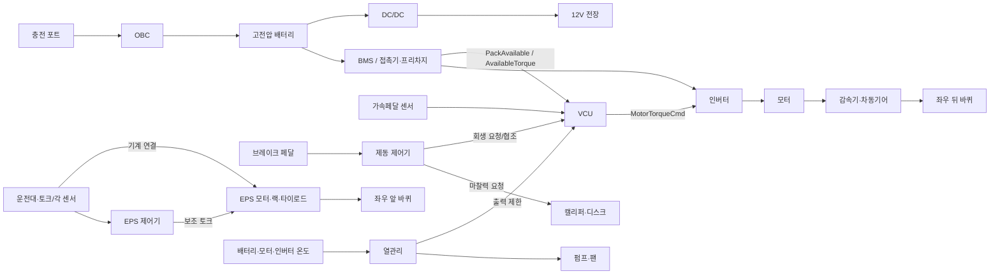

# 차량 시스템 아키텍처와 기능 범위 점검

2026-10-28 · 개발·콘텐츠 검토 문서. 이 문서의 구현 범위와 한계는 게임 화면의 대사가 아니라 제작·검수 기준이다.

## 결론

**필수 기능 전체 제작은 이 프로젝트의 완료 목표이며, 2026-10-29 현재 플레이 범위는 아직 그 기준에 못 미친다.** 직접 블록을 구성해 시험하는 기능은 8개(BMS 배터리 사용 가능 판단, VCU START 요청 허용, 전력 사용 허용, 운전자 토크 요청, 전진 구동 허용, 마찰 제동력 요청, 앞바퀴 각도 변환, 출력 라우팅)다. BMS 판단 출력은 VCU 전력 허용을 거쳐 실제 구동력을 차단하며 같은 물리 틱의 기록에 남는다. 고전압 접촉기·프리차지, 배터리 가용 토크, 충전, 저전압 공급, 열관리, 제동 협조·ABS/ESC, EPS 보조, 진단은 `vehicleSystems.ts`의 상태 계산과 선택형 실험실 중심이다. 플레이어 START 허용 그래프가 실제 프리차지 상태기의 입력을 결정한다. 접촉기와 프리차지 상태전이 그래프는 아직 플레이어가 만들지 않는다. 제작 로직의 제동·조향 요청과 회생·마찰·EPS 계산은 하나의 물리 명령으로 전달되고, 주행 화면과 조립 3D 일부가 같은 프레임의 수치를 참조한다. 충전·열관리·ABS/ESC의 장치 애니메이션과 플레이어 제작 미션, 전용 내부 단면 3D는 미완료다. 전체 에피소드와 기능별 완료 조건은 [EV 에피소드·계층 매트릭스](EV_EPISODE_AND_HIERARCHY_MATRIX_2026-10-28.md)에 기록한다.

이번 기준 차량은 **단일 구동 모터·후륜구동 BEV, 운전대와 랙의 기계 연결을 유지하는 전륜 EPS, 회생·마찰 제동 협조, 기능별 분산 ECU**로 고정한다. 차종과 OEM마다 ECU 배치가 달라지므로 이것을 유일한 산업 표준으로 주장하지 않는다. 충전·DC/DC·열관리까지 동일한 차의 장치와 기능으로 연결하되, 플레이 제작 순서를 한 기능씩 확장한다.

## 1. 서로 다른 다섯 관점을 섞지 않는 규칙

| 관점 | 묻는 질문 | 이 게임의 기준 | 화면에서 보일 위치 |
|---|---|---|---|
| 기능 아키텍처 | 차가 무엇을 해야 하는가 | System → Domain → Function; 에너지·구동·제동·조향·섀시·열관리·차량 통합/진단 | 플레이 중 우측 기능 트리, 전체 구조 탭 |
| 물리 아키텍처 | 무엇이 에너지·힘을 전달하는가 | 배터리→인버터→모터→감속·차동기어→후륜, 캘리퍼·디스크, 운전대·랙·전륜 | 조립·부품 관찰·주행·설계 지도 |
| E/E 아키텍처 | 어떤 ECU·센서·액추에이터가 통신하는가 | BMS, VCU, 인버터 제어, 제동 제어, EPS 제어의 기능별 배치 | 기능별 입출력 경계, 전체 구조 탭의 토폴로지 |
| SW 아키텍처 | 제어기 안의 계산이 어떻게 실행되는가 | Application SWC → Runnable; RTE/BSW는 배치 설명만 | SW 로직 제작 경로·블록 실행 |
| 검증 아키텍처 | 무엇을 어떤 수준에서 판정하는가 | 독립 요구사항 입출력 사례 → 시스템 상태 → 차량 운동·주행 | 로직 동작 확인, 시스템 실험실, 컵 주행 |

`Domain`과 `ECU`는 같은 계층이 아니다. **System/Domain/Function**은 기능 분해, **ECU/SWC/Runnable**은 기능의 실행 배치다. 한 기능이 여러 ECU에 걸치거나 한 ECU가 여러 기능을 실행할 수 있다. AUTOSAR Classic의 Application/RTE/BSW 구분을 참고하지만 현재 코드의 블록 그래프는 ARXML, RTE 태스크·이벤트, BSW, 실제 ECU 배포물을 생성하지 않는다. Runnable은 SWC 내부의 실행 단위이며 RTE 이벤트에 의해 호출될 수 있다. 이는 [AUTOSAR Classic Platform](https://www.autosar.org/standards/classic-platform/)과 [RTE 명세](https://www.autosar.org/fileadmin/standards/R24-11/CP/AUTOSAR_CP_SWS_RTE.pdf)에 근거한다.

### 선택한 차량의 기능 → ECU → SWC → Runnable

| 기능 | ECU | SWC / Runnable | 직접 구성 |
|---|---|---|---|
| 전력 사용 허용 | VCU | PowerAvailabilitySWC / ComputePowerEnable | 예 |
| 운전자 모터 토크 요청 | VCU | DriverDemandSWC / ComputeDriverTorque | 예 |
| 전진 구동 허용 | VCU | DriveInterlockSWC / CheckDriveAllow | 예 |
| 마찰 제동력 요청 | 제동 제어기 | BrakeDemandSWC / ComputeBrakeForce | 예 |
| 앞바퀴 각도 변환 | 조향 제어기 | SteeringGeometrySWC / MapDriverToFrontAngle | 예, 단 EPS 보조 토크 제어와 분리 필요 |
| 도메인 출력 라우팅 | VCU·제동·EPS 제어기 경계 | VehicleCommandInterface / RouteActuatorRequests | 예, 배포 위치는 세분화 필요 |

`MODEL_SPECS`는 위 **Application 기능 계산의 게임 요구사항·입출력·시험 데이터**다. 전체 차량 기능 명세나 ECU 세부 설계가 아니다. `MODEL_ALLOCATION`은 현재 차량의 할당 예시이며 완성된 배포 모델이 아니다. `SteeringGeometrySWC`가 산출하는 `FrontWheelAngle`은 차량 운동 입력에 가까우며, 기계 연결 EPS가 실제로 제어할 보조 토크·전류와 같은 명령이라고 해석하면 안 된다.

## 2. 선택한 물리·E/E 연결

화살표는 기능·에너지·기계 경계를 함께 보여주는 개념 토폴로지다. 신호 버스의 특정 프로토콜(CAN, Ethernet), 프레임·메시지·주기·진단 식별자는 아직 지정하지 않았다. 이 때문에 현재 구현을 완성된 E/E 통신 설계라고 부를 수 없다. 분산/도메인/중앙+존은 동일 기능의 **배치 선택지**이고, 현재 차는 분산형이다. [Bosch의 E/E 아키텍처 개요](https://www.bosch-mobility.com/en/mobility-topics/ee-architecture/)도 기능별·도메인·중앙/존 구성을 구분한다.

## 3. 차량 필수 기능별 실제 코드 수준

표의 “시스템 계산”은 `vehicleSystems.ts`의 간략한 이산시간 상태 계산을 뜻한다. “제작 미션”은 플레이어가 부품을 다루고 로직 그래프를 만들고 독립 사례로 검증하는 게임 흐름을 뜻한다. 이 둘을 완료로 합산하지 않는다.

| 기능·요소 | 제작 미션 | 시스템 계산·표시 | 남은 연결 |
|---|---|---|---|
| START 요청 허용·READY·기어 상태 | START 허용 그래프 직접 구성·주행 조작 | 허용 요청이 실제 프리차지로 연결; READY/접촉기 상태 계산 | 프리차지·접촉기 상태 머신을 제작·고장 시험하는 미션 |
| 배터리 감시·가용 토크 | BMS PackSafe 직접 구성·배터리 장착 | SOC·온도·절연 판단이 주행 차단에 연결; 가용 토크는 상태 계산 | 가용 토크 제작, 센서·접촉기·고장 경로 |
| 고전압 접촉기·프리차지 | 장착·배선 미션 없음 | PRECHARGE/READY 상태 | 장치·배선·시간·전압 조건의 조립·로직·검증 |
| OBC 충전·DC/DC·12V | 제작 미션 없음 | 충전 전류·DC/DC 활성·전압 | 충전 포트·OBC·DC/DC 시각화와 제작·검증 |
| 전력 사용 허용 | **직접 구성** | 주행 허용 입력에 반영 | BMS 상태/접촉기 실제 신호와 하나의 실행 경로 |
| 운전자 토크 요청·전진 인터록 | **직접 구성 2개** | 요청→명령→응답 계산 | 역방향·주차·페달 이중화·출력 제한 체계 |
| 인버터·모터 제어 | 부품 장착, 액추에이터 관찰 | 토크 응답·후륜 토크 | 전류/속도 제어, 회생과 열 한계의 동적 결합 |
| 감속기·차동기어·후륜축·타이어 | 장착·주행 | 단순 토크 분할·차량 운동 | 차동·접지·현가와 시험을 일관된 상태로 연결 |
| 제동력 요청 | **직접 구성** | 마찰·회생·휠별 제동력 | 네 바퀴 브레이크 시각화·압력/힘 경계 |
| 회생 협조·ABS·ESC | 제작 미션 없음 | 간략한 회생 제한·휠 슬립/요 오차 분기 | 독립 제어 기능·고장/경계 시험·주행 피드백 |
| 조향각 변환 | **직접 구성** | 전륜 각도 | 기계 연결 각도와 EPS 모터 명령 분리 |
| EPS 보조 토크 | 제작 미션 없음 | 차속 의존 보조량 | 토크 센서·전류 제어·고장 반응·조향 느낌 |
| 열관리 | 제작 미션 없음 | 펌프/팬·출력 제한 | 냉각 경로·부품 온도·제어 기능 제작 |
| E/E 신호 연결·진단 | 출력 라우팅 **직접 구성** | 신호 지연·진단 목록 | 실제 네트워크 토폴로지, 신호 소유자·주기·타임아웃 |
| 차체·등화·와이퍼·안전장치 | 주요 주행 기능 밖 | 일부 3D 형상만 | 신입 교육 목표에 포함할지 별도 제품 범위 결정 |

배터리, 전기모터, 인버터, OBC, DC/DC, 열관리 등 BEV 주요 장치의 분류는 [미국 DOE AFDC의 BEV 구성 설명](https://afdc.energy.gov/vehicles/how-do-all-electric-cars-work)을 기준으로 확인했다. 전륜 EPS는 기계 연결과 전기 보조의 구분을 유지하며, Steer-by-Wire와 혼동하지 않는다([Bosch EPS](https://www.bosch-mobility.com/en/solutions/steering/electric-power-steering-systems/)).

## 4. 플레이 단계별 정보 배치와 데이터 출처

| 플레이 지점 | 플레이어가 이해할 것 | 현재 데이터·화면 | 보완 기준 |
|---|---|---|---|
| 첫 주행 | START/READY·P/R/N/D·페달·조향을 직접 조작 | `DomainCampaign.tsx`, 주행 런타임 | 주행 조건과 실패 이유를 조작 위치에 표시 |
| 부품 파악·장착 | 에너지원/센서/ECU/액추에이터/기계 전달 구분 | `domains.ts`의 `PART_CLASS`, `ASSEMBLY_KITS`, `assembly.ts` | 네 바퀴·브레이크·EPS 물리 장치와 신호 경계를 일치 |
| 각 도메인 조작 | 지금 도메인의 조건, 입력, 물리 반응 | `domainTraining.ts`의 `ROUNDS` | 개념 설명을 주행 관찰과 한 화면에서 대응 |
| SW 로직 구현 | 현재 기능의 System/Domain/Function 위치, 실행 ECU/SWC/Runnable, 요구사항·입출력 | `MODEL_SPECS`, `MODEL_CONTEXT`, `MODEL_ALLOCATION`, `ArchitectureCompass`, `DomainEditor` | 기능 트리와 별도 배치 경로를 유지; 블록 의미와 실제 실행을 일치 |
| 로직 동작 확인 | 같은 입력의 블록 값→출력→장치 결과, PASS/FAIL | `verifyModel`, `evaluateModel`, `DomainEditor` | 그래프의 활성 선과 물리 반응의 동일 시간축 강화 |
| 기능 복구 | 방금 만든 기능이 제어기에서 장치까지 통과 | `FunctionRecoveryTrace.tsx` | 전력/신호/기계 경로 색을 분리하고 같은 시점에 재생 |
| 시스템 통합·설계 지도 | 모든 기능과 ECU 배치·E/E·물리 결과 | `VehicleArchitectureTree.tsx`, `VehicleBlueprint.tsx`, `VehicleSystemsLab.tsx` | 8개 미션 외 기능도 누락 없이 지도에 노출, 상태 계산과 3D 연동 |

이번 변경의 `ArchitectureCompass`는 각 플레이 단계의 우측 안내에 현재 위치를 표시한다. 차체 조립은 물리 구조 가지로 표시하며 ECU/SWC 아래에 넣지 않는다. 전체 구조 탭은 19개 기능 경로(직접 구성 8개 + 지원 경로 11개)를 기능별 선택형 트리로 보여준다. 지원 경로에도 `SUPPORT_ALLOCATION`으로 대표 ECU/SWC/Runnable 또는 기계 경로와 목표 에피소드를 기록했다. 전력·신호·기계의 7개 연결 경로는 `vehicleArchitecture.ts`의 `TOPOLOGY_PATHS`가 소유하고 카드로 표시한다. **화면에 경로가 보인다는 것과 플레이어가 그 경로를 제작한다는 것은 다르다.** 현재 기능 트리의 `Domain` 레이블은 시동/구동 “단계”가 아닌 에너지·전원/구동/제동/조향 등 기능 도메인으로 수정했다.

2026-10-28 UX 보완: 플레이 중 기능 트리와 전체 구조의 트리는 기본 접힘이다. 전체 구조는 선택 기능의 입력→ECU→SWC/Runnable→출력→물리 반응을 5단계 그래픽으로 선택하거나 재생할 수 있다. 전력/신호/기계 경로는 탭을 선택해 한 관점씩 본다. 이는 현재 정적 구조 데이터를 순서대로 보여주는 시각 설명이며, 로직 실행 샘플과 3D 차량 부품이 시간 동기화된 추적은 아직 아니다. 그 차이는 [UX 점검](UX_AUDIT_2026-10-28.md)에 기록했다.

## 5. 우선 설계 작업과 완료 기준

1. **단일 아키텍처 데이터 모델**: `MODEL_SPECS`, `VEHICLE_FUNCTIONS`, `MODEL_ALLOCATION`, 부품·배선 데이터를 ID로 연결한다. 기능 ID마다 요구사항, ECU/SWC/Runnable, 센서, 출력, 액추에이터, 전력·통신·기계 경로, 검증 사례를 추적 가능하게 저장한다. 중복 문자열로 매칭하지 않는다.
2. **전력·충전 에피소드**: BMS 감시 → 접촉기/프리차지 → READY → 인버터 허용, 충전 포트/OBC → 팩, DC/DC → 12V를 장치·블록·시험·물리 반응으로 완결한다.
3. **구동·제동·조향 심화**: 토크 요청과 모터 명령/응답, 네 바퀴 마찰·회생 협조/ABS/ESC, 기계 EPS의 운전자 토크와 보조 모터 토크를 각각 분리한 미션으로 만든다.
4. **실제 E/E 배치 모델**: 각 신호의 송신·수신 ECU, 통신 링크, 주기, 유효성·타임아웃을 정의하고 기능 트리·배선·실행 추적에 한 번만 기록한다. 중앙/도메인/존 대안은 선택 지도에서 현재 분산형과 비교하되 게임 진행을 바꾸려면 별도 저장·검증 설계가 필요하다.
5. **실행 추적**: 페달 또는 START 한 이벤트를 시간축에서 블록 입력→Runnable 출력→ECU 경계→액추에이터→차량 운동까지 같은 샘플로 재생한다. 마지막 설계 지도는 텍스트 목록 대신 이 추적을 기본 화면으로 삼는다.
6. **검수**: 미션마다 정상·경계·고장 입력, 기대/실제 값, 주행·장치 피드백을 독립적으로 확인한다. UI에서는 현재 위치·다음 조작·실패 이유를 짧게 보여주고 구현 범위 설명은 이 문서에 둔다.

새 기능이 “완료”되는 기준은 **부품·배선/입출력 정의 → 플레이어 로직 또는 명시적 장치 역할 → 독립 검증 → 동일 차량의 물리 반응 → 설계 지도 추적 → 저장/복귀**가 전부 이어지는 것이다. 현재 `vehicleSystems.ts`에 계산식이 있다는 이유만으로 완료 처리하지 않는다.
