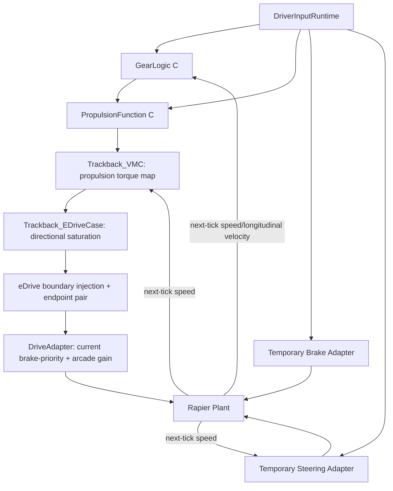

# TRACKBACK Phase 01~04 정적 감사 독립 검토 및 정정 결정서

- 작성일: 2026-10-07
- 근거: Codex 작성 `01_ARCHITECTURE_CODE_AUDIT.md`~`05_RECOMMENDED_CORRECTIONS.md`, 이전 Phase 01~04 설계 초안.
- 검토 수준: **Codex 코드 감사 보고의 근거와 내부 논리를 독립 검토한 것**. 이번 세션에 최신 프로젝트 원본 `src/`, `c/`, `tests/`가 통째로 제공되지 않았으므로 코드 재실행/독립 정적 검사/빌드 재현을 뜻하지 않는다.
- 기준선: 앱의 현재 단일 추진 슬라이스와 시험 경로를 보존한다. 74 LF/111 신호 후보/49 경계 후보는 **설계 커버리지**, 곧 runtime 지원 범위가 아니다.

## A. 승인/보류의 뜻

`REVIEWED_CORRECTION` = 감사 보고에 제시된 근거와 설계 목적상 정정 방향을 승인한다. 이는 해당 공학 설계·수치·안전성·차량 적합성을 보증하지 않는다.

`ACCEPT_SCOPE` = 기능 추가 없이 설명 범위를 바로잡는 것으로 충분하다.

`APPROVAL_REQUIRED` = 제어권·요구사항·Calibration 등 새 동작 결정은 사람이 승인해야 한다.

`OPEN_CODE_VALIDATION` = Codex의 행 번호/소스 서술은 보고되었으나 원본 코드를 직접 확인하고 테스트해야 한다.

## B. 결론: 설계 오류, 표현 오류, 미구현을 구분

| Issue | 재판정 | 조치 | 근거와 이유 |
|---|---|---|---|
| `ARC-001` | `ACCEPT_SCOPE` | 74 LF 역할의 `VERIFIED 5 / PARTIAL 27 / DESIGN_ONLY 42`를 구현 능력과 별도 metadata로 등록 | 참조 모델을 축소/삭제하지 않는다. Audit coverage는 역할 완결성이지 소스 파일 개수 아님 |
| `ARC-002` | `REVIEWED_CORRECTION` | `Trackback_VMC`의 *실행 표시명*은 Propulsion Torque Generation, 논리적 Motion Coordination은 `DESIGN_ONLY` | VMC 함수는 단일 추진 요구·속도 torque map. C symbol 즉시 rename하지 않음 |
| `ARC-003` | `APPROVAL_REQUIRED` | 기존 brake > 0이면 driveForce=0 정책을 **HOST_BRAKE_OVER_DRIVE_POLICY**로 외부화할 설계 계획 승인 필요 | 지금은 adapter가 실제 억제 판단 수행. Full Brake/MC arbitration이 구현됐다고 주장하지 않음. 정책 이동 시 출력/결함 주입/replay 동등성 회귀 필요 |
| `ARC-004` | `REVIEWED_CORRECTION` | `VehicleReady`/`PropulsionEnable`은 `SimulationRuntime`의 host proxy/assumption으로 표시 | 실행 입력의 `vehicleReady = physics != null`; `propulsionEnable = true`, UI publish enable은 별도 조건. 실제 vehicle state machine 부재 |
| `GT-001` | `REVIEWED_CORRECTION` | statement review·calibration provenance·implementation·verification status를 네 축으로 구분 | `APPROVED` statement + `REVIEW_REQUIRED` calibration은 **다른 승인 축**이므로 반드시 요구사항 자체가 논리적으로 틀렸다는 증명은 아님. 하지만 같은 승인으로 제시하면 오도 |
| `GT-002` | `REVIEWED_CORRECTION` | `SYSR-PROP-009`는 end-to-end SYSR로 유지하고 VMC·eDrive **다중 할당 또는 분할된 하위 검증**을 표현 | 현재 단일 VMC allocation은 내용 범위를 온전히 반영 못 함. 요구사항 원문 무단 수정 금지 |
| `GT-003` | `REVIEWED_CORRECTION` | TC-001~005는 `LINKED_DETAIL_MISSING`으로 표시 | canonical TC 상세를 테스트 파일로부터 검토 가능한 형태로 채우거나 정당화해 재연결하기 전에는 완결 TC로 보여주지 않음 |
| `GT-004` | `ACCEPT_SCOPE` | repository 자동 테스트와 player workbench capability를 별도 | TC-011/012 자동 테스트 존재는 Workbench에서 실행된다는 뜻 아님; 고장 아님 |
| `SIG-001` | `ACCEPT_SCOPE` | 입력원 `[0,1]` clamp, 포트의 number-only acceptance, C에서 finite 및 clamp 처리 **각 단계별 계약** | 동일 signal의 동일 검증 규칙이라고 가정하면 모순. 포트 정책의 차이는 반드시 bug란 뜻은 아님 |
| `SIG-002` | `REVIEWED_CORRECTION` | EDriveCommand struct / `magnitudeNm`, calibration FWD 180/R 130 Nm로 후보 카탈로그 수정 | 수치가 실제 source 설정이라는 근거와 공학적으로 승인된 수치라는 근거는 구분 |
| `SIG-003` | `REVIEWED_CORRECTION` | 14 structural registry edges ≠ 14 independently observed interfaces. eDrive→DriveAdapter만 single-tick 양쪽 **분리 객체로 기록** | source/dest를 같은 함수에서 clone하여 기록. 이것만으로 독립 HW/송수신 계측이나 네트워크 실제 수신 시각을 검증했다고 주장할 수 없음 |
| `TIM-001` | `ACCEPT_SCOPE` | 전체 C chain + Rapier는 60Hz 고정 tick; Scheduler/Network task 10/20ms는 설계 전용 | real-time deadline이나 AUTOSAR runnable 10ms 구현 주장 금지 |
| `TIM-002` | `REVIEWED_CORRECTION` | `tickStartTime`과 `tickEndTime`, event timestamp와 observation timestamp 분리 | t에서 fault 적용, t+dt에서 plant 측정은 의도적으로 다른 사건일 수 있어 자체로 계산 bug는 아님. 단일 `time` 필드로 동일시할 때 의미가 틀려짐 |
| `PHY-001` | `ACCEPT_SCOPE` | `10 N/Nm`를 `SIM_TORQUE_TO_FORCE_GAIN` arcade 계수로 명시 | gear ratio/wheel radius/efficiency로 계산된 actual force 아님 |
| `PHY-002` | `ACCEPT_SCOPE` | wheel slip/yaw 센서 모델 없으면 ABS/ESC/ADAS 설계만 유지 | Rapier pose truth ≠ sensor/estimator output |
| `FLT-001` | `REVIEWED_CORRECTION` | FI `RESTORED`는 Injector path 복원, ECU Fault Recovery가 아님 | 진단 상태·DTC·Fault Confirmation·Fail-safe 기능 없음 |
| `FLT-002` | `ACCEPT_SCOPE` | hidden game answer oracle ≠ independent root cause detector | 게임 내 culprit leakage 금지; assessment는 게임 판정으로 분리 |
| `VER-001` | `REVIEWED_CORRECTION` | 독립 algorithm oracle과 공유 calibration의 provenance 병기 | 다른 함수라는 사실만으로 기준·보정 독립성이 보장되지는 않음 |
| `VER-002` | `ACCEPT_SCOPE` | Vehicle scenario는 Expected oracle 부재 시 `OBSERVED`만 | requirement criterion reference가 실행 가능한 PASS/FAIL rule 아님 |
| `DOC-001` | `REVIEWED_CORRECTION` | `docs/reference_vehicle/`를 기존 입력 기준 문서 폴더로 유지하고 감사 문서도 그 아래로 **후속 승인 migration** | 원래 audit은 `reference-vehicle/`에 작성됨. 사용자 원본/기존 역사 파일을 삭제하지 말고 복사 후 경로 추적 |
| `UI-001` | `REVIEWED_CORRECTION` | `SteeringDemandNormalized` (ratio)와 `FrontWheelSteeringAngleRad` (rad)를 제안 semantic ID로 구분 | 기존 변수/코드 symbol은 유지; 실제 API 필드 이름 바로 교체하지 않음 |
| `UI-002` | `REVIEWED_CORRECTION` | raw source accelerator와 FI 후 SW delivered accelerator 분리 표시 | HUD source 값과 C input이 FI 상황에서 같지 않을 수 있음 |

## C. 현 실행 기준선 (Codex 정적 감사의 기술 사실)

- 프로파일: normalized Accelerator, GearRequest P/R/N/D, brake ratio, steering ratio.
- C 함수 실행 순서: `GearLogic → Propulsion → VMC → eDrive`; 별도 Runnable scheduler 없음.
- VMC torque map은 속도에 따른 가용 토크 감쇠. Multi-request arbitration 없음.
- eDrive directional limit: **FWD 180 / REV 130 Nm** (현재 simulation calibration 기반, `REVIEW_REQUIRED`).
- Adapter: **10 N/Nm** arcade conversion, brake > 0일 때 propulsion force 0. Temporary brake **6500 N** maximum; steering **0.42/(1+speed×0.07) rad** (speed m/s 입력으로 보고됨). 이들은 현재 시뮬레이터 제약이지 실차 통합제어기 요구사항이 아니다.
- Gear: D↔R opposite transition을 `|longitudinal velocity| ≤ 0.5m/s`일 때만 허용. P/N ↔ D/R 적용은 별도 brake/park interlock 없음. Invalid gear request면 이전 상태 유지 + validity INVALID.
- Actual Propulsion State: `PROP_ENABLED/PROP_DISABLED` 두 상태. Reference `PROP_OFF/READY/ACTIVE/DEGRADED`와 동등하지 않음.
- Rapier는 speed magnitude(3D norm)와 signed forward longitudinal velocity를 별도 제공. wheel slip, ABS/ESC sensor, torque feedback 없음.
- Clock: SW/physics 모두 `1/60s` fixed tick; vehicle scenario observations t+dt, FI endpoint event t. Source/sink 별 event time 반드시 구분.

## D. 지켜야 할 불변식 (실행 보존 기준)

1. 현재 WASM ABI/production C seam의 실행 동작과 P/N inhibit, D/R direction, accelerator finite clamp, Gear D↔R interlock을 비승인 변경하지 않는다.
2. brake >0 정책을 추출하더라도 현재 `driveForce=0` 결과가 입력 전체에서 동일해야 한다. 다만 그 정책 자체의 타당성/차량 요구사항 승인은 별개다.
3. `RequestedDriveTorque`, `DriveTorqueRequest`, `EDriveCommand`, `DriveForce`를 임의 alias 하지 않는다.
4. `EDriveCommand`는 magnitude Nm+direction+validity이며 force는 signed N. 명령 ≠ 실측 토크.
5. 요구사항/검증 결과 표시에는 statement approval, calibration review, oracle provenance, runner type이 독립적으로 나타난다.
6. Player에게 아직 조사하지 않은 culprit/hardcoded internal fault mechanism(예: variant scale)을 공개하지 않는다.
7. FI event 시각과 physics observation 시각을 혼동하지 않는다. source/dest clone에서 MATCH를 보였더라도 CAN receive/timeout 검증이라고 하지 않는다.
8. `OBSERVED`와 PASS/FAIL을 혼용하지 않는다. 구체적 executable oracle이 있는 범위에서만 PASS/FAIL 표시.

## E. 후속 작업을 별도 승인해야 하는 질문

- Brake >0 추진 억제 정책은 실제 차량 참조 안전 요구사항으로 유지할 것인가, 단지 게임 arcade 운전 정책인가? **현재는 GAME_HOST_POLICY**로만 분류.
- `VehicleReady`, `PropulsionEnable`의 진짜 Vehicle State owner를 지금 신설할 것인가? 현재 동작을 보존하려면 즉시 신설보다 **HOST_ASSUMPTION** 표시를 우선 권고.
- Calibration `REVIEW_REQUIRED`에서 계산되는 expected 판정은 사용자가 어디까지 '참조 게임 기준'으로 승인하는가?
- Source/destination telemetry는 같은 injection 함수에서 생성된 pair를 교육용 비교에 허용할 것인가? **허용하더라도 실제 독립 네트워크 endpoint라고 주장할 수 없음.**
- 추후 Brake SW, Motion Coordination, CAN Scheduler를 어떤 순서로 구현할 것인가? 현재 데이터만으로 결정 불가.
- Git 추적이 확인된 정규 문서 경로를 결정한 뒤 기존 audit hyphen 경로에서 승인이 완료된 파일만 이동할 것.

## F. 소스 없이 검증했다고 주장해서는 안 되는 것

- 정적 보고서에 source file/line이 적혀 있다는 사실과, 본 세션에서 그 소스를 직접 읽거나 실행했다는 것은 다르다.
- `build.json`과 계산한 SHA256의 일치는 그 **manifest가 해당 artifact 집합을 지칭함**을 보여준다. 그것만으로 C source에서 .wasm을 생성하는 컴파일러 실행이 실제로 그 소스를 사용했다거나 reproducible build라고 증명하지는 못한다. 필요하면 clean rebuild와 동일 빌드 옵션/툴체인 및 behavior checks로 따로 확인.
- Codex는 재실행 테스트를 일부러 건너뛰었으므로 실제 회귀 검증 PASS는 현재 주장할 수 없다.
- ISO 26262, ASIL, 양산 SW/HIL/SIL 적합성도 이 감사 범위 밖이다.

## G. 변경 적용 순서

**G0 (코드 의미 정정만)**: 정규 docs 경로 결정, 역할·상태·interface capability 메타데이터 확정. `TC-001~005` unresolved 처리. UI/API/실행 의미 레이블 먼저 바로잡기.

**G1 (제어권 분리, 사람 승인 이후)**: HOST_BRAKE_OVER_DRIVE_POLICY 계약+Regression Goldens 작성 → DriveAdapter에서 결정 부분 분리 → 비정상도 포함 완전 동일성 확인.

**G2 (Signal/Time 계약)**: Producer/consumer·unit/validity·event timestamp, steering ratio/angle 분리, raw/delivered 분리. 현 C ABI 불변.

**G3 (Verification의 범위)**: approval provenance, reference vs executable expected, TC definitions, test-run evidence schema, injection vs recovery 명시.

**G4 (회귀 Gate)**: WASM clean rebuild verification, typecheck/lint/tests, incident/replay/vehicle steering/brake/FI, evidence persistence, genuine player investigation flow. 이번 문서 교정 단계에서는 실행하지 않았음.

**Phase 05 진입 조건:** G0 의미 계약을 승인하고, P0 제어권·보정값 문제의 정책 선택 또는 명시적 미승인을 끝내야 한다. 74개 모든 LF 구현 완료는 조건 아님.
