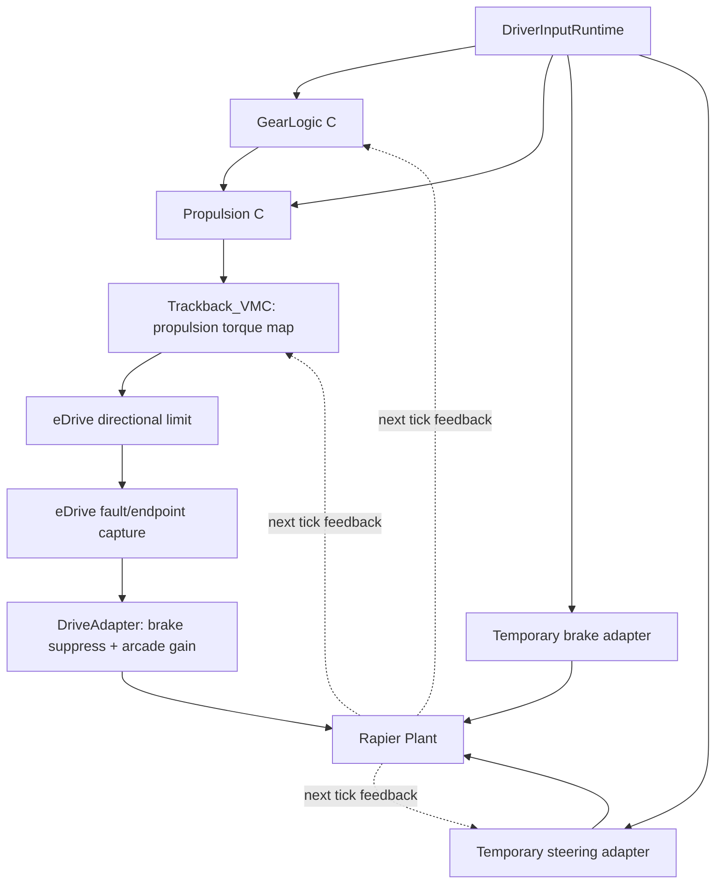
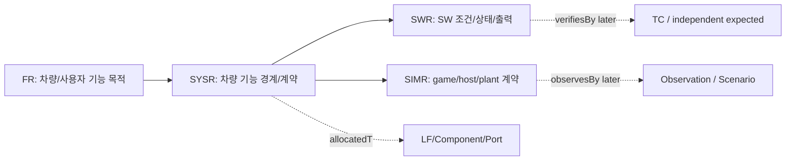
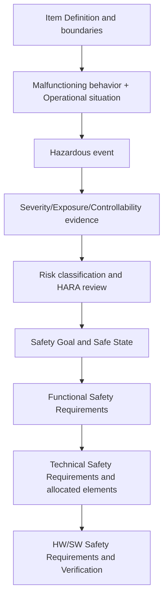

# TRACKBACK — Phase 05 Requirements Engineering (차량 전체 FR·SYSR·SWR·SIMR)

> Document: 05_REQUIREMENTS_ENGINEERING_KO  
> Version: 0.3  
> Status: REVIEWED_DRAFT  
> Canonical: YES  
> Last Reviewed: 2026-10-10  
> Runtime Baseline: current narrow propulsion slice; candidate requirements do not imply implementation  
> Scope: FR/SYSR/SWR/SIMR reference requirements; no HARA/SG/FSR/TSR/ASIL approval

> **버전:** v0.3 · **작성일:** 2026-10-10 · **상태:** `REVIEWED_DRAFT / NOT APPROVED`
> **중요:** 이 문서는 Phase 01~04 참조 아키텍처와 2026-10-07 Codex 정적 감사 결과를 바탕으로 작성한 **신규 요구사항 후보**다. 기존 `PropulsionGroundTruth.ts`의 21개 statement를 변경하지 않았고, 자동차 제조사·ISO 26262 인증/기능안전 승인·실차 제어 적합성을 주장하지 않는다. 최신 저장소 소스 재실행 및 코드 변경은 수행하지 않았다.

## v0.3 요구사항 계약 교정

요구사항 종류는 다음 의미로 사용한다.

- `FR`: 기능 필요 또는 capability intent.
- `SYSR`: 외부에서 관찰 가능한 system-level behavior 또는 system responsibility.
- `SWR`: 명시된 software owner에 할당되고 검증 가능한 software contract.
- `SIMR`: simulation/test-environment behavior 또는 assumption.

`statementStatus`, `implementationStatus`, `verificationStatus`, `calibrationStatus`, `safetyLifecycleStatus`는 독립 축이다. `SW_OWNER_TBD`인 SWR은 `APPROVED/FROZEN`일 수 없고 `DRAFT/OPEN/BLOCKED_BY_OPEN_DECISION`으로 유지한다. 임의 owner를 배정하지 않는다.

### 교정된 authority requirements

- Reference Motion Coordination은 typed motion requests와 `ConstraintSet`을 수집하고, vehicle-level longitudinal authority/selection reason, feasible target 및 drive-vs-brake allocation을 소유한다.
- Propulsion과 Braking은 각 domain processing과 domain final command를 소유한다. `LF-BRK-CMD`가 유일한 logical final braking-domain command owner다.
- `LF-BRK-COORD`는 할당된 braking objective를 total/allocated brake demand로 조정하고 `LF-BRK-BLEND`는 available regen/friction actuator 사이에서 배분한다. Energy는 availability/capability/constraint만 제공한다.
- Vehicle State는 initialization, operational state, `DomainAvailability`, drive permission, degraded state, recovery authorization를 별도 계약으로 관리한다. Host readiness/enable 값은 reference output의 구현 증거가 아니다.
- ADAS feature output은 `controlOutputKind`를 선언하고 direct actuator ownership은 기본 승인하지 않는다.
- ABS/TCS/ESC 상세 placement, brake blending algorithm, EPS authority, lateral reference quantity, ADAS priority, energy/regen, production diagnostics는 `EXTERNAL_VALIDATION_REQUIRED`다.

현재 C/WASM/host/Rapier 구현은 이 참조 계약에 맞추어 변경하지 않았으며 `HOST_DRIVE_BRAKE_ARBITRATION_POLICY`는 계속 `CURRENT_RUNTIME_POLICY`다.

## 목차
1. 근거·요구사항 등급·승인 계약
2. 시스템 경계와 현재 구현 기준선
3. FR → SYSR → SWR/SIMR 설계 원칙
4. 16개 영역의 상세 요구사항
5. 도메인 간 통합·상태·제어권 요구
6. 기존 Propulsion 요구사항 보존 및 ID Crosswalk
7. 기능안전 HARA → SG → FSR → TSR 분기와 승인 Gate
8. 검증 가능성·TC 설계 준비
9. 미결정 사항 및 승인 절차

## 1. 근거·상태 및 승인 계약

| 우선 근거 | 문서 및 한계 |
|---|---|
| 원본 사용자 자료 | `Requirement.md` 전체 게임·참조 차량 명세, `TRACKBACK Propulsion Reference Requirements v0.1.md` 9개 정상 흐름·FR/SYS/SWR/TC. 둘 다 실제 OEM 제어기 명세가 아님. |
| Phase 01~04 검토본 | `reference_vehicle/review/` v0.2: 16개 영역, 74개 LF, 111개 signal 후보, 49개 interface 후보. 논리적 범위와 구현 증거는 별개. |
| 2026-10-07 코드 감사 보고 | 사용자 업로드 `01_ARCHITECTURE_CODE_AUDIT.md`~`05_RECOMMENDED_CORRECTIONS.md`: 소스 경로와 호출 경계에 관한 **Codex 정적 분석 보고**, 본 작성 환경에서 최신 코드/테스트를 직접 실행한 것은 아님. |
| 기존 Canonical | `PropulsionGroundTruth.ts` 내 21개 `APPROVED` statement의 개별 전문·실제 배포 버전은 보고서로 간접 확인. 자동 병합이나 업데이트 금지. |

**표기 규칙**

- `CAND-` 접두어는 이 문서에서만 사용하는 고유 후보 ID. 기존 `FR-PROP-*`, `SYS-PROP-*`, `SWR-PROP-*`, `SYSR-PROP-*`, `TC-*`를 **교체하거나 같은 요구사항으로 자동 연결하지 않는다.**
- `SYSR`는 참조 차량의 기능적·인터페이스 결과 책임, `SWR`는 논리적 Software 기능의 내부 처리·포트·상태 책임, `SIMR`는 **게임 입력·시뮬레이터/Plant/계측 호스트 구현 책임**이다. 물리 차량 요구사항과 혼합하지 않는다.
- `CAND-SWR`는 SWC 또는 ECU의 존재를 뜻하지 않는다. 현 실행 owner가 없는 경우 `SW_OWNER_TBD`이며 구현은 `DESIGN_ONLY`로 유지한다.
- 승인 축: `statementReviewStatus`, `calibrationReviewStatus`, `implementationCoverage`, `verificationCapability`, `oracleStatus`, `evidenceProvenance`. 서로 다른 축의 `APPROVED` 값을 상호 전파하지 않는다.
- 참조 신호의 기술명이나 참조 상태의 전이가 실행 코드와 같다는 가정은 금지한다. 미결정값은 `OPEN`, 해당 요구사항은 승인·자동 PASS/FAIL 불가로 취급한다.

## 2. 현재 실행 기준선과 참조 범위

| 항목 | 보고된 현재 동작 | 설계에만 존재하는 범위 |
|---|---|---|
| C/WASM | Gear → Propulsion → VMC 단일 torque map → eDrive 방향별 포화 | 독립 Motion Coordination / 복수 요청 arbitration / 감시·Fault Recovery |
| Gear | D↔R 전환의 `abs(LongitudinalVelocity) ≤ 0.5m/s` 제한, invalid hold | 완전한 기어 인터록, 적용 액추에이터 피드백 |
| 추진 입력 | C non-finite → 0, finite 값 clamp; disabled/P/N → 0 demand | VehicleReady/Enable을 계산하는 독립 상태 제어기 |
| 제동·조향 | 임시 host adapter: 6500N 제동·속력 연동 조향각 | Brake SWC/EPS, ABS/TCS/ESC, ADAS |
| 강제 우선권 | `brake > 0`이면 DriveAdapter의 `driveForce=0` | 승인된 Motion Arbitration 소유권과 정책 |
| 실행 시간 | C chain + Rapier 1/60s tick | 10/20ms Runnable·CAN schedule·watchdog·deadline |
| 측정/시험 | eDrive boundary의 same-function two-object source/destination 계측, observation-only vehicle scenario | 독립 network TX/RX, 차량 궤적 자동 Expected, HW CAN |
| 보정값 | FWD 180/REV 130 Nm; 10 N/Nm, 6500 N 등 simulation calibration `REVIEW_REQUIRED` | OEM 승인 torque mapping·실차 braking limit |

## 3. 요구사항 계층과 기술 방식

**수준 구분 예 — 브레이크 입력과 propulsion 억제**

| Level | 좋은 서술 | 나쁜 서술 |
|---|---|---|
| FR | 유효한 제동 요구에 대해 차량이 정의된 제동 반응을 제공할 수 있어야 한다. | `brake > 0`이면 `DriveForce=0`으로 한다. (Arcade 임시 구현 정책임) |
| SYSR | 충돌하는 가속·제동 요구를 명시된 제어권 규칙에 따라 선택하고 선택 사유를 제공한다. | 구동·제동 소프트웨어 내부 조건을 불분명한 책임으로 반복 |
| SWR | 정책 소유자가 결정된 선택 결과를 받아 구동 요구를 제어 명령에 반영한다. | `EDriveToVehiclePhysicsAdapter`가 Brake ECU 전 기능을 수행한다. |
| SIMR | 현 host adapter는 `brake > 0` 시 `driveForce=0`을 산출한다(현상 유지용 as-is). | 이를 실제 ECU Brake Safety Mechanism으로 단정 |

**완전성 판단 규칙:** 모든 승인 대상 문장은 단일 기능 책임, 적용 조건, 처리 대상, 기대 결과, 조건 미충족/Invalid 경로, 허용오차·시간(필요할 때), 검증 경계, 실제 출처를 식별해야 한다. 현재 없는 값으로 문장을 메우지 말고 `OPEN`으로 둔다. 아래 `CAND-SYSR`는 이러한 승인 관문을 통과하기 전 **초안**이다.

## 4. 차량 전체 16개 영역 요구사항 초안

요구사항 수: **32개 FR 후보 + 74개 SYSR 후보 + 62개 SWR 후보 + 12개 SIMR 후보 = 180개 후보**. SYSR/하위 구현 계약은 74개 LF 전체에 연결하되, SWC·Runnable·ECU를 1:1로 생성하지 않는다. `CAND-`와 `DESIGN_ONLY`는 테스트용 Ground Truth가 아니다.

### 4.1. 운전자·환경 — 3개 Function

**`CAND-FR-INPUT_ENV-001`** — 운전자 조작은 다른 종류의 제어 요구 및 물리 명령과 구분하여 사용 가능해야 한다.

**`CAND-FR-INPUT_ENV-002`** — 환경 제공자는 실제 모델링된 도로·교통·차선 정보의 범위와 가용성을 명시해야 한다.

#### LF-DRV-ACQ — CAND-SYSR-DRV-ACQ

- **상위 FR:** `CAND-FR-INPUT_ENV-001` · **보고된 실제 역할:** `PARTIAL` · **기존 참조 FR:** `없음`
- **SYSR 후보 / 차량 기능 경계:** 운전자 조작 이벤트가 입력되면 차량 시뮬레이션은 가속, 제동, 조향, 기어 요청을 구분해 소비 경로에 제공해야 한다.
- **기대 관측·출력:** 서로 다른 4종 입력의 값과 같은 tick에서 사용된 입력의 구분.
- **SIMR 후보 `CAND-SIMR-DRV-ACQ` / 내부 처리:** 호스트 입력 계층은 원본값, 조정값(slew/clamp), SW 전달값을 구분 가능하도록 제공하며 처리 순서를 유지한다.
- **검증 설계:** 각 입력을 바꾼 뒤 의도한 소비 경로에 반영되는지 관측한다.
- **`OPEN` / 승인 차단:** 이벤트/샘플 시각과 raw/delivered 공개 범위.
- **코드 감사 근거 요약:** `DriverInputRuntime` 입력·slew·clamp (`src/runtime/driver/DriverInputRuntime.ts:7-38`)

#### LF-DRV-VALID — CAND-SYSR-DRV-VALID

- **상위 FR:** `CAND-FR-INPUT_ENV-001` · **보고된 실제 역할:** `PARTIAL` · **기존 참조 FR:** `없음`
- **SYSR 후보 / 차량 기능 경계:** 조작 입력을 소비하는 기능에는 입력의 값과 해당 입력의 해석 가능 여부를 혼동하지 않도록 전달해야 한다.
- **기대 관측·출력:** 값의 clamp와 VALID/INVALID 의미는 독립된 속성.
- **SIMR 후보 `CAND-SIMR-DRV-VALID` / 내부 처리:** 호스트는 적용한 clamp·변환 정책을 명시하고, SW 포트와 C 함수는 자신의 유효성/finite 처리 정책을 별도로 구현한다.
- **검증 설계:** 정상 범위, out-of-range, nonfinite, 명시적 INVALID를 개별 시험한다.
- **`OPEN` / 승인 차단:** brake/steer validity와 freshness 개념 부재; source-port 정책 차이.
- **코드 감사 근거 요약:** setter clamp, 기본 validity (`DriverInputRuntime.ts:16-18`, `:41`, `:52-57`)

#### LF-ENV-STATE — CAND-SYSR-ENV-STATE

- **상위 FR:** `CAND-FR-INPUT_ENV-002` · **보고된 실제 역할:** `PARTIAL` · **기존 참조 FR:** `없음`
- **SYSR 후보 / 차량 기능 경계:** 도로·노면·가상 객체 정보를 사용하는 기능은 제공된 환경 상태의 종류와 가용성에 따라 처리해야 한다.
- **기대 관측·출력:** road/surface 정보와 object/lane 정보의 제공 여부 구분.
- **SIMR 후보 `CAND-SIMR-ENV-STATE` / 내부 처리:** 환경 제공자는 모델링한 노면·구간 상태만 발행하고 미구현 traffic/lane/object는 unavailable로 표현한다.
- **검증 설계:** 노면 설정과 plant 반응만 관측; ADAS object/lane 기준 시험 불가.
- **`OPEN` / 승인 차단:** 환경 모델의 차량 좌표계·갱신 주기·시뮬레이션 진실값 정의.
- **코드 감사 근거 요약:** map surface/route가 Rapier에 공급 (`src/physics/rapier/RapierVehiclePhysics.ts:20-35`, `:72-80`)

### 4.2. 차량 상태·모드 — 4개 Function

**`CAND-FR-VEHICLE_STATE-001`** — 차량은 기능 가용성과 주행 허용 여부를 판단하는 데 필요한 상태를 관리할 수 있어야 한다.

**`CAND-FR-VEHICLE_STATE-002`** — 운용 모드 전환 및 장애로 인한 기능 제한은 영향 범위를 식별 가능해야 한다.

#### LF-VS-INIT — CAND-SYSR-VS-INIT

- **상위 FR:** `CAND-FR-VEHICLE_STATE-001` · **보고된 실제 역할:** `PARTIAL` · **기존 참조 FR:** `없음`
- **SYSR 후보 / 차량 기능 경계:** 차량 가용성은 실행 호스트가 구동 중인지와 차량 기능이 준비됐는지를 구분할 수 있어야 한다.
- **기대 관측·출력:** host physics 존재와 VehicleReady를 동일한 승인 의미로 전파하지 않음.
- **SWR 후보 `CAND-SWR-VS-INIT` / 내부 처리:** 상태 제공자는 호스트 리소스 가용성 및 차량 상태 입력을 별도 이름과 provenance로 내보내야 한다.
- **검증 설계:** physics=null, reset, restart에서 host proxy만 시험 가능.
- **`OPEN` / 승인 차단:** VehicleReady 실제 제어기 소유자와 초기 전이/실패 정의.
- **코드 감사 근거 요약:** runtime reset, physics 존재 기반 ready (`src/runtime/SimulationRuntime.ts:328`, `:403`)

#### LF-VS-PERM — CAND-SYSR-VS-PERM

- **상위 FR:** `CAND-FR-VEHICLE_STATE-001` · **보고된 실제 역할:** `PARTIAL` · **기존 참조 FR:** `없음`
- **SYSR 후보 / 차량 기능 경계:** 구동이 허용된 조건인지 판단할 때 준비, 기어, 기능 허용 및 유효성을 명시된 정책에 따라 함께 고려해야 한다.
- **기대 관측·출력:** 구동 허용 결과와 적용한 차단 이유.
- **SWR 후보 `CAND-SWR-VS-PERM` / 내부 처리:** 권한 계산 SW는 조건별 거짓/무효 시 정책 출력 및 근거를 제공하도록 설계한다; 현재 host의 true 입력은 별도 assumption으로 기록한다.
- **검증 설계:** 현재 host 입력 gate의 C zero request만 관측; 독립 permission TC 보류.
- **`OPEN` / 승인 차단:** DriveEnable 생성 owner, false·invalid 우선순위, brake 연계 정책.
- **코드 감사 근거 요약:** `vehicleReady && propulsionEnable` gate (`c/vehicle_sw/core.c:9`, `c/vehicle_sw/propulsion.c:9`)

#### LF-VS-MODE — CAND-SYSR-VS-MODE

- **상위 FR:** `CAND-FR-VEHICLE_STATE-002` · **보고된 실제 역할:** `DESIGN_ONLY` · **기존 참조 FR:** `없음`
- **SYSR 후보 / 차량 기능 경계:** 차량 운용 모드를 지원한다면 요청 모드와 현재 적용 모드를 혼동하지 않고 보고해야 한다.
- **기대 관측·출력:** 선택된 모드, 적용 여부, 변경 보류/거절 이유.
- **SWR 후보 `CAND-SWR-VS-MODE` / 내부 처리:** 모드 관리 기능은 request→guard→accepted mode→publish 전이를 정의된 조건에 따라 처리하도록 설계한다.
- **검증 설계:** 상태 전이표 승인 전 expected 불가.
- **`OPEN` / 승인 차단:** 지원 모드 목록, 유효 전이 및 reset 모드 없음.
- **코드 감사 근거 요약:** 실행 owner 없음

#### LF-VS-FAULT — CAND-SYSR-VS-FAULT

- **상위 FR:** `CAND-FR-VEHICLE_STATE-002` · **보고된 실제 역할:** `DESIGN_ONLY` · **기존 참조 FR:** `없음`
- **SYSR 후보 / 차량 기능 경계:** 확정된 기능 장애가 차량 가용성에 영향을 주는 경우, 적용 범위에 맞는 제한 정보를 제공해야 한다.
- **기대 관측·출력:** 전체 OFF와 특정 기능 제한을 구분한 availability 결과.
- **SWR 후보 `CAND-SWR-VS-FAULT` / 내부 처리:** 가용성 집계기는 확인된 domain fault status만 입력으로 사용하고 시험 injector 상태를 fault로 사용하지 않는다.
- **검증 설계:** Fault manager 미구현; 관측·판정 불가.
- **`OPEN` / 승인 차단:** fault 판단 owner, degraded 정책, 해제 guard.
- **코드 감사 근거 요약:** 실행 owner 없음

### 4.3. Gear — 4개 Function

**`CAND-FR-GEAR-001`** — 운전자가 요청한 기어와 최종 적용 기어를 구별해 처리해야 한다.

**`CAND-FR-GEAR-002`** — 허용되지 않는 기어 전환과 입력 오류의 처리 근거를 관찰 가능해야 한다.

#### LF-GEAR-ACQ — CAND-SYSR-GEAR-ACQ

- **상위 FR:** `CAND-FR-GEAR-001` · **보고된 실제 역할:** `PARTIAL` · **기존 참조 FR:** `없음`
- **SYSR 후보 / 차량 기능 경계:** 유효한 P/R/N/D 선택 요청은 적용 기어 상태와 구분되어 기어 판단으로 전달되어야 한다.
- **기대 관측·출력:** 요청값, validity, 수신/사용 여부.
- **SWR 후보 `CAND-SWR-GEAR-ACQ` / 내부 처리:** Gear 입력 처리 SW는 요청값과 유효성 상태를 개별 필드로 보존하고 invalid는 명시적으로 표시한다.
- **검증 설계:** component direct 입력과 live UI를 구분 시험.
- **`OPEN` / 승인 차단:** live invalid 요청 경로, timestamp/freshness.
- **코드 감사 근거 요약:** `GearRequest`, validity input (`VehicleSwPort.ts:8-9`)

#### LF-GEAR-INTERLOCK — CAND-SYSR-GEAR-INTERLOCK

- **상위 FR:** `CAND-FR-GEAR-002` · **보고된 실제 역할:** `PARTIAL` · **기존 참조 FR:** `없음`
- **SYSR 후보 / 차량 기능 경계:** 현재 TRACKBACK 프로파일에서 D와 R 간 방향 반대 전환은 종방향 속도 조건을 만족할 때만 허용되어야 한다.
- **기대 관측·출력:** 현재 D↔R 요청에서 abs(LongitudinalVelocity) ≤ 0.5 m/s인 경우 허용; 초과 시 상태 유지.
- **SWR 후보 `CAND-SWR-GEAR-INTERLOCK` / 내부 처리:** GearLogic은 previous gear와 signed longitudinal velocity를 이용해 D↔R 전환 여부를 결정하고 수락 정보를 내보낸다.
- **검증 설계:** D→R, R→D 경계·초과·정지 및 P/N 요청을 범위 한정 시험.
- **`OPEN` / 승인 차단:** 0.5m/s는 시뮬레이션 값이며 P/N·브레이크·park interlock은 별도 설계.
- **코드 감사 근거 요약:** D↔R speed interlock (`c/vehicle_sw/gear.c:7-11`)

#### LF-GEAR-STATE — CAND-SYSR-GEAR-STATE

- **상위 FR:** `CAND-FR-GEAR-001` · **보고된 실제 역할:** `PARTIAL` · **기존 참조 FR:** `없음`
- **SYSR 후보 / 차량 기능 경계:** 적용 기어와 전환 수락 여부는 요청 입력과 분리하여 이용 가능해야 한다.
- **기대 관측·출력:** 적용 P/R/N/D 상태와 TransitionAccepted, GearStateValidity.
- **SWR 후보 `CAND-SWR-GEAR-STATE` / 내부 처리:** GearLogic은 거절/invalid 시 previous gear를 유지하고 현재 validity를 출력한다.
- **검증 설계:** invalid request, moving reverse에서 hold와 flag를 비교.
- **`OPEN` / 승인 차단:** 물리 gear actuator 상태 없음; accepted 와 engaged의 구분.
- **코드 감사 근거 요약:** previous gear 보존 및 applied state (`c/vehicle_sw/gear.c:3-13`)

#### LF-GEAR-REACT — CAND-SYSR-GEAR-REACT

- **상위 FR:** `CAND-FR-GEAR-002` · **보고된 실제 역할:** `DESIGN_ONLY` · **기존 참조 FR:** `없음`
- **SYSR 후보 / 차량 기능 경계:** 기어 전환 실패의 원인이 관찰 가능한 경우, 단순 요청 거부와 진단 확정 장애를 구분해야 한다.
- **기대 관측·출력:** 거절 사유, 진단 상태, 복귀 가능성은 별개.
- **SWR 후보 `CAND-SWR-GEAR-REACT` / 내부 처리:** 기어 반응 SW는 별도 승인된 진단 입력에만 fault reaction을 연결하도록 설계한다.
- **검증 설계:** 현재 전환 거절을 DTC로 판정하지 않음.
- **`OPEN` / 승인 차단:** 실패·Timeout·원인 분류·복귀 Guard 없음.
- **코드 감사 근거 요약:** 실행 owner 없음

### 4.4. Propulsion — 10개 Function

**`CAND-FR-PROPULSION-001`** — 운전자 가속 요구에 따라 해당 조건에서 허용된 구동 요구를 생성·전달해야 한다.

**`CAND-FR-PROPULSION-002`** — 구동 가용성·제한·고장·복귀를 정상 명령 생성과 구분해 관리할 수 있어야 한다.

#### LF-PROP-STA — CAND-SYSR-PROP-STA

- **상위 FR:** `CAND-FR-PROPULSION-002` · **보고된 실제 역할:** `PARTIAL` · **기존 참조 FR:** `FR-PROP-STA-001;FR-PROP-STA-002`
- **SYSR 후보 / 차량 기능 경계:** 구동 기능은 적용 가능한 준비/활성/제한 상태를 근거 있는 조건에 따라 보고해야 한다.
- **기대 관측·출력:** 실행은 PROP_ENABLED/DISABLED 2상태, 참조 OFF/READY/ACTIVE/DEGRADED와 별개.
- **SWR 후보 `CAND-SWR-PROP-STA` / 내부 처리:** 현 C는 허용 및 기어 gate로 enable을 출력하고, 4상태 참조 상태 전이는 새 상태 owner가 승인된 경우에만 도입한다.
- **검증 설계:** 실행 2상태만 component로 관측, 참조 상태 Expected 없음.
- **`OPEN` / 승인 차단:** Reference READY/ACTIVE/DEGRADED 전이의 ELSE/우선순위/회복.
- **코드 감사 근거 요약:** `PROP_ENABLED`/`PROP_DISABLED` (`src/runtime/c/WasmVehicleSw.ts:49-52`)

#### LF-PROP-ACQ — CAND-SYSR-PROP-ACQ

- **상위 FR:** `CAND-FR-PROPULSION-001` · **보고된 실제 역할:** `PARTIAL` · **기존 참조 FR:** `FR-PROP-IN-001;FR-PROP-IN-002`
- **SYSR 후보 / 차량 기능 경계:** 가속 요청의 유효성 또는 운행 차단 조건이 충족되지 않으면 유효한 구동 요구를 사용해서는 안 된다.
- **기대 관측·출력:** invalid/disable/P/N 상황의 zero request 및 validity 의미 분리.
- **SWR 후보 `CAND-SWR-PROP-ACQ` / 내부 처리:** C Propulsion 입력 처리 단계는 accelerator/gear validity를 확인하고 disabled/P/N에서 zero request를 산출한다.
- **검증 설계:** invalid pedal/gear, enable=false, gear P/N의 zero 처리 관측.
- **`OPEN` / 승인 차단:** invalid를 0 magnitude와 별도 invalid status로 표현하는 계약.
- **코드 감사 근거 요약:** pedal/gear validity와 availability gate (`c/vehicle_sw/propulsion.c:3-10`)

#### LF-PROP-INTERP — CAND-SYSR-PROP-INTERP

- **상위 FR:** `CAND-FR-PROPULSION-001` · **보고된 실제 역할:** `VERIFIED` · **기존 참조 FR:** `FR-PROP-REQ-001`
- **SYSR 후보 / 차량 기능 경계:** 유효하게 허용된 가속 입력은 정규화된 구동 요구로 해석되어야 한다.
- **기대 관측·출력:** 정규화 요구 비율 [0,1], finite 아닌 입력의 처리 의미.
- **SWR 후보 `CAND-SWR-PROP-INTERP` / 내부 처리:** C는 nonfinite 입력을 0으로 처리하고 finite out-of-range는 [0,1]로 clamp한 후 direction/validity가 있는 요청 구조체를 만든다.
- **검증 설계:** finite, negative, >1, nonfinite, D/R 방향 분리 시험.
- **`OPEN` / 승인 차단:** 원본 v0.1 PedalDemandMap의 20% 예시와 현재 선형 맵의 승인 관계.
- **코드 감사 근거 요약:** finite 처리, `[0,1]` clamp, direction 선택 (`c/vehicle_sw/propulsion.c:10-15`)

#### LF-PROP-GEN — CAND-SYSR-PROP-GEN

- **상위 FR:** `CAND-FR-PROPULSION-001` · **보고된 실제 역할:** `PARTIAL` · **기존 참조 FR:** `FR-PROP-GEN-001`
- **SYSR 후보 / 차량 기능 경계:** 유효한 구동 요구와 차속에 대해 방향 정보가 보존된 토크 요구가 제공되어야 한다.
- **기대 관측·출력:** DriveTorqueRequest magnitude Nm, Direction 및 Validity.
- **SWR 후보 `CAND-SWR-PROP-GEN` / 내부 처리:** 실제 Trackback_VMC 계산은 단일 PropulsionRequest와 speed로 방향별 최대토크·zero-torque-speed 감쇠 맵을 적용한다.
- **검증 설계:** 같은 방향·속력별 출력, 경계 및 단위 검증.
- **`OPEN` / 승인 차단:** 참조 RequestedDriveTorque·ArbitratedDriveTorque와 alias 금지; calibration review.
- **코드 감사 근거 요약:** 실행 `VMC`의 속력 기반 torque map (`c/vehicle_sw/vmc.c:3-13`)

#### LF-PROP-LIM — CAND-SYSR-PROP-LIM

- **상위 FR:** `CAND-FR-PROPULSION-002` · **보고된 실제 역할:** `PARTIAL` · **기존 참조 FR:** `FR-PROP-LIM-001;FR-PROP-LIM-002`
- **SYSR 후보 / 차량 기능 경계:** 전달 가능한 최종 구동 요구는 명시된 제한을 초과하지 않아야 한다.
- **기대 관측·출력:** 현 eDrive 명령 magnitude는 정방향 ≤180, 역방향 ≤130 Nm.
- **SWR 후보 `CAND-SWR-PROP-LIM` / 내부 처리:** eDrive는 direction별 calibration 최대값에 따라 요청 magnitude를 포화한다.
- **검증 설계:** component saturation 및 방향별 상한 검증.
- **`OPEN` / 승인 차단:** 180/130 Nm REVIEW_REQUIRED; 참조 300Nm와 혼동 금지, regen 별도.
- **코드 감사 근거 요약:** eDrive directional saturation (`c/vehicle_sw/edrive.c:3-10`)

#### LF-PROP-OUT — CAND-SYSR-PROP-OUT

- **상위 FR:** `CAND-FR-PROPULSION-001` · **보고된 실제 역할:** `PARTIAL` · **기존 참조 FR:** `FR-PROP-OUT-001`
- **SYSR 후보 / 차량 기능 경계:** 명령 출력 단계는 요구 명령과 유효성·방향을 유지하여 후속 경계에 전달해야 한다.
- **기대 관측·출력:** EDriveCommand Nm와 별도 direction/validity; plant N으로 변환되기 전 단계.
- **SWR 후보 `CAND-SWR-PROP-OUT` / 내부 처리:** eDrive 출력과 전달 계측은 명령을 Nm 구조체로 보존하고 drop/override은 전달 지점에 별도 적용한다.
- **검증 설계:** same-tick source/destination 관측쌍과 정상 전달 비교.
- **`OPEN` / 승인 차단:** DriveTorqueCommand 참조 alias 미승인, physical actual feedback 없음.
- **코드 감사 근거 요약:** `EDriveCommand` 출력과 adapter 전달 (`VehicleSwPort.ts:21-22`, `SimulationRuntime.ts:347-352`)

#### LF-PROP-MON — CAND-SYSR-PROP-MON

- **상위 FR:** `CAND-FR-PROPULSION-002` · **보고된 실제 역할:** `DESIGN_ONLY` · **기존 참조 FR:** `FR-PROP-MON-001`
- **SYSR 후보 / 차량 기능 경계:** 구동 요청과 명령의 일관성을 감시한다면 독립 관측과 공차가 명시되어야 한다.
- **기대 관측·출력:** 명령 차이, tolerance, 감시 상태 및 판정 근거.
- **SWR 후보 `CAND-SWR-PROP-MON` / 내부 처리:** 제안 Monitor는 제한 후 기대 명령과 실제 관측을 비교하되 임계값·debounce 승인이 없으면 FaultConfirmed를 생성하지 않는다.
- **검증 설계:** 현 runtime monitor 없음; 검증 불가.
- **`OPEN` / 승인 차단:** 독립 관측, 허용오차, 지속조건, fault owner.
- **코드 감사 근거 요약:** `RUNTIME_LAYERS.MONITORING = NOT AVAILABLE` (`VehicleSwPort.ts:40-48`)

#### LF-PROP-REACT — CAND-SYSR-PROP-REACT

- **상위 FR:** `CAND-FR-PROPULSION-002` · **보고된 실제 역할:** `DESIGN_ONLY` · **기존 참조 FR:** `FR-PROP-REA-001`
- **SYSR 후보 / 차량 기능 경계:** 구동 고장이 확정된 경우에 한해 정의된 제한 동작을 적용해야 한다.
- **기대 관측·출력:** fault confirmed에 대한 제한 상태와 선택된 torque constraint.
- **SWR 후보 `CAND-SWR-PROP-REACT` / 내부 처리:** 고장 대응 SW는 확인된 진단 상태에서만 제한/차단 요구를 생성하도록 설계한다.
- **검증 설계:** FI와 ECU fault 반응 혼동 금지; 현 시험 불가.
- **`OPEN` / 승인 차단:** 고장 검출·확정 owner, 제한 수치(50Nm는 참조 예시), 안전 근거.
- **코드 감사 근거 요약:** 실행 owner 없음

#### LF-PROP-REC — CAND-SYSR-PROP-REC

- **상위 FR:** `CAND-FR-PROPULSION-002` · **보고된 실제 역할:** `DESIGN_ONLY` · **기존 참조 FR:** `FR-PROP-REC-001`
- **SYSR 후보 / 차량 기능 경계:** 확정된 고장 후 구동 복귀에는 고장 해소와 복귀 허용 조건이 함께 필요하다.
- **기대 관측·출력:** 준비 복귀/활성 복귀 간 상태와 적용 조건.
- **SWR 후보 `CAND-SWR-PROP-REC` / 내부 처리:** 복귀 관리 SW는 fault-clear만으로 Active로 바로 전환하지 않고 승인된 rearm guard를 확인해야 한다.
- **검증 설계:** Injector RESTORED는 도메인 recovery 시험 근거 아님.
- **`OPEN` / 승인 차단:** guard, hysteresis, reset, 운전자 재요청 기준.
- **코드 감사 근거 요약:** 실행 owner 없음

#### LF-PROP-EDRV — CAND-SYSR-PROP-EDRV

- **상위 FR:** `CAND-FR-PROPULSION-001` · **보고된 실제 역할:** `VERIFIED` · **기존 참조 FR:** `없음`
- **SYSR 후보 / 차량 기능 경계:** eDrive 명령은 유효한 방향별 토크 요구를 포화해 다음 명령 단계로 전달해야 한다.
- **기대 관측·출력:** 명령 magnitude Nm, Direction/Validity, 상한.
- **SWR 후보 `CAND-SWR-PROP-EDRV` / 내부 처리:** Trackback_EDriveCase는 FWD/REV 방향별 limit를 적용하고 명령 구조체를 출력한다; defect variant는 시험 모델 분기로 별도 표시한다.
- **검증 설계:** C production seam과 독립 TS expected를 calibration 조건부 비교.
- **`OPEN` / 승인 차단:** 실제 모터/인버터/열/전류 제어 부재; mutation은 정상 요구가 아님.
- **코드 감사 근거 요약:** C eDrive 방향별 limit (`c/vehicle_sw/edrive.c:3-10`)

### 4.5. Braking — 7개 Function

**`CAND-FR-BRAKING-001`** — 제동 요구가 존재하면 해당 요구의 출처·유효성을 고려해 제동 효과를 요청할 수 있어야 한다.

**`CAND-FR-BRAKING-002`** — 복수 제동원·구동원·회생제동 및 피드백을 처리할 때 제어권과 실제 적용 효과를 구분해야 한다.

#### LF-BRK-ACQ — CAND-SYSR-BRK-ACQ

- **상위 FR:** `CAND-FR-BRAKING-001` · **보고된 실제 역할:** `PARTIAL` · **기존 참조 FR:** `없음`
- **SYSR 후보 / 차량 기능 경계:** 운전자 및 지원되는 외부 제동 요청은 요청 출처가 구별되어 전달되어야 한다.
- **기대 관측·출력:** 현재는 driver brake ratio만 실제, AEB/ESC는 미래 요청.
- **SWR 후보 `CAND-SWR-BRK-ACQ` / 내부 처리:** 요구 입력 계층은 driver ratio를 읽으며 미래 복수 요청은 source/validity가 명확한 request object를 사용한다.
- **검증 설계:** 현재 driver 값 전달만 관측.
- **`OPEN` / 승인 차단:** 외부 source arbitration, 유효성/시간, 요청 단위 미정.
- **코드 감사 근거 요약:** driver brake ratio (`DriverInputRuntime.ts:17`, `SimulationRuntime.ts:353`)

#### LF-BRK-STATE — CAND-SYSR-BRK-STATE

- **상위 FR:** `CAND-FR-BRAKING-001` · **보고된 실제 역할:** `DESIGN_ONLY` · **기존 참조 FR:** `없음`
- **SYSR 후보 / 차량 기능 경계:** 제동 가능 상태는 구동계 허용 상태와 독립적으로 판단되어야 한다.
- **기대 관측·출력:** Braking availability와 degraded 상태가 있다면 별도 보고.
- **SWR 후보 `CAND-SWR-BRK-STATE` / 내부 처리:** 제동 상태 기능은 자체 가용성·fault를 기준으로 제동 요구의 허용/차단을 결정한다.
- **검증 설계:** 현재 brake adapter 존재를 BrakeAvailable로 간주하지 않음.
- **`OPEN` / 승인 차단:** Brake SW/Actuator 상태·fault 모델 없음.
- **코드 감사 근거 요약:** 실행 owner 없음

#### LF-BRK-DEMAND — CAND-SYSR-BRK-DEMAND

- **상위 FR:** `CAND-FR-BRAKING-001` · **보고된 실제 역할:** `DESIGN_ONLY` · **기존 참조 FR:** `없음`
- **SYSR 후보 / 차량 기능 경계:** 승인된 제동 입력에 대해 요구 감속 또는 제동량의 의미를 정한 뒤 전달해야 한다.
- **기대 관측·출력:** 정규화 ratio와 목표 감속/force/torque는 서로 다른 물리량.
- **SWR 후보 `CAND-SWR-BRK-DEMAND` / 내부 처리:** 제동 요구 기능은 명시된 맵을 통해 request type/unit가 있는 요구를 생성하도록 설계한다.
- **검증 설계:** 현 6500N adapter는 logical demand 함수의 시험 근거 아님.
- **`OPEN` / 승인 차단:** 목표 변수 선택, 맵, 페달 물성, coast 조건 없음.
- **코드 감사 근거 요약:** logical demand owner 없음

#### LF-BRK-COORD — CAND-SYSR-BRK-COORD

- **상위 FR:** `CAND-FR-BRAKING-002` · **보고된 실제 역할:** `DESIGN_ONLY` · **기존 참조 FR:** `없음`
- **SYSR 후보 / 차량 기능 경계:** 복수 제동 요구와 구동 요구가 충돌할 때 제어권을 정의된 정책에 따라 결정해야 한다.
- **기대 관측·출력:** 선택된 제동 요구, 구동 억제 여부, 권한 결정 사유.
- **SWR 후보 `CAND-SWR-BRK-COORD` / 내부 처리:** 향후 Coordination SW는 driver/AEB/ESC request의 validity/source를 평가한다; 현재 brake>0이면 driveForce=0은 host adapter 정책이다.
- **검증 설계:** 현 brake-over-drive만 observed; multi-source TC 불가.
- **`OPEN` / 승인 차단:** policy owner 변경 승인, AEB/ESC 우선순위, 정상 동등성.
- **코드 감사 근거 요약:** 실행 owner 없음

#### LF-BRK-BLEND — CAND-SYSR-BRK-BLEND

- **상위 FR:** `CAND-FR-BRAKING-002` · **보고된 실제 역할:** `DESIGN_ONLY` · **기존 참조 FR:** `없음`
- **SYSR 후보 / 차량 기능 경계:** 회생·마찰 제동을 함께 사용할 때 사용 가능 제약을 고려하여 요구를 배분해야 한다.
- **기대 관측·출력:** 재생 torque, 마찰 요구와 최종 총 제동 효과.
- **SWR 후보 `CAND-SWR-BRK-BLEND` / 내부 처리:** Blending SW는 energy regen constraint를 읽고 잔여 제동 요구를 마찰 측으로 배분하도록 설계한다.
- **검증 설계:** 재생제동 없음; 시뮬레이션 구동력을 음수로 임의 적용 금지.
- **`OPEN` / 승인 차단:** regen 가능성/부호/명령 단위, 에너지 상태, 우선권.
- **코드 감사 근거 요약:** 실행 owner 없음

#### LF-BRK-CMD — CAND-SYSR-BRK-CMD

- **상위 FR:** `CAND-FR-BRAKING-001` · **보고된 실제 역할:** `PARTIAL` · **기존 참조 FR:** `없음`
- **SYSR 후보 / 차량 기능 경계:** 제동 명령을 생성하는 경로는 요구값과 물리 적용 단위를 명시해야 한다.
- **기대 관측·출력:** 현 brakeForce는 0~6500 N 범위의 plant command.
- **SWR 후보 `CAND-SWR-BRK-CMD` / 내부 처리:** 임시 adapter는 brake ratio에 6500 N 계수를 적용한다; 향후 Brake SW 명령은 이 direct path와 분리해야 한다.
- **검증 설계:** 정규화 입력 경계값과 plant command 관측.
- **`OPEN` / 승인 차단:** 6500 N 공학 승인 없음; Brake pressure/feedback 없음.
- **코드 감사 근거 요약:** temporary TS force mapping (`TemporaryBrakeSteeringAdapters.ts:4-7`)

#### LF-BRK-FDBK — CAND-SYSR-BRK-FDBK

- **상위 FR:** `CAND-FR-BRAKING-002` · **보고된 실제 역할:** `DESIGN_ONLY` · **기존 참조 FR:** `없음`
- **SYSR 후보 / 차량 기능 경계:** 제동 명령의 실제 적용 반응을 감시할 때 독립 피드백의 의미를 명시해야 한다.
- **기대 관측·출력:** 명령, 관측 감속, 실제 제동 작용의 차이.
- **SWR 후보 `CAND-SWR-BRK-FDBK` / 내부 처리:** 감시 SW는 독립 관측이 존재할 때만 편차를 계산하고 진단 대응을 요청하도록 설계한다.
- **검증 설계:** Rapier 감속만으로 실제 Brake actuator 검증 불가.
- **`OPEN` / 승인 차단:** pressure, wheel torque, feedback source, tolerance 없음.
- **코드 감사 근거 요약:** 실행 owner 없음

### 4.6. Steering — 6개 Function

**`CAND-FR-STEERING-001`** — 운전자 조향 의도를 적절한 제어 요구로 해석하고 적용 경로에 전달할 수 있어야 한다.

**`CAND-FR-STEERING-002`** — 보조 조향 개입·가용성 저하·실제 작동 관측을 운전자 입력과 구분해야 한다.

#### LF-STR-ACQ — CAND-SYSR-STR-ACQ

- **상위 FR:** `CAND-FR-STEERING-001` · **보고된 실제 역할:** `PARTIAL` · **기존 참조 FR:** `없음`
- **SYSR 후보 / 차량 기능 경계:** 운전자 조향 요청은 조향각 명령과 분리된 정규화 입력으로 제공되어야 한다.
- **기대 관측·출력:** Driver steering ratio [-1,1] 및 출처.
- **SWR 후보 `CAND-SWR-STR-ACQ` / 내부 처리:** 입력 계층은 ratio를 기록하고 LKA 등 향후 assist source를 별도 request로 구분한다.
- **검증 설계:** normalized input과 final rad command 혼동 방지.
- **`OPEN` / 승인 차단:** 조향 센서 validity 및 운전자 override 조건 미정.
- **코드 감사 근거 요약:** driver normalized steering (`DriverInputRuntime.ts:18`)

#### LF-STR-STATE — CAND-SYSR-STR-STATE

- **상위 FR:** `CAND-FR-STEERING-002` · **보고된 실제 역할:** `DESIGN_ONLY` · **기존 참조 FR:** `없음`
- **SYSR 후보 / 차량 기능 경계:** 조향 기능 가용성/지원 방식에 따라 유효한 조향 명령의 범위를 결정해야 한다.
- **기대 관측·출력:** EPS/SbW/Arcade 모드 구분과 상태.
- **SWR 후보 `CAND-SWR-STR-STATE` / 내부 처리:** 조향 상태 SW는 지원한 제어 방식 및 fault를 별도 관리하도록 설계한다.
- **검증 설계:** 현재 steering direct adapter는 EPS state 아님.
- **`OPEN` / 승인 차단:** 실제 EPS/SbW 선택, 진단/recovery.
- **코드 감사 근거 요약:** 실행 owner 없음

#### LF-STR-DEMAND — CAND-SYSR-STR-DEMAND

- **상위 FR:** `CAND-FR-STEERING-001` · **보고된 실제 역할:** `PARTIAL` · **기존 참조 FR:** `없음`
- **SYSR 후보 / 차량 기능 경계:** 조향 입력은 정해진 단위와 속도 의존 변환에 따라 최종 각도 요구로 해석되어야 한다.
- **기대 관측·출력:** 현재 front steering command(rad)는 ratio×0.42/(1+speed×0.07).
- **SWR 후보 `CAND-SWR-STR-DEMAND` / 내부 처리:** 임시 adapter는 normalized ratio와 VehicleSpeed(m/s)를 입력으로 rad 명령을 산출한다.
- **검증 설계:** 입력 -1/0/1과 여러 speed에서 rad 출력 관측.
- **`OPEN` / 승인 차단:** 0.42/0.07 arcade 값과 제어 안정성 검토, bound 검증.
- **코드 감사 근거 요약:** speed-dependent angle mapping (`TemporaryBrakeSteeringAdapters.ts:8-10`)

#### LF-STR-COORD — CAND-SYSR-STR-COORD

- **상위 FR:** `CAND-FR-STEERING-002` · **보고된 실제 역할:** `DESIGN_ONLY` · **기존 참조 FR:** `없음`
- **SYSR 후보 / 차량 기능 경계:** 복수 조향 요구가 존재하면 운전자와 보조 요구의 제어권을 명시적으로 결정해야 한다.
- **기대 관측·출력:** 선택된 lateral request와 override reason.
- **SWR 후보 `CAND-SWR-STR-COORD` / 내부 처리:** 조향 조정 SW는 request 출처·유효성·허용 상태에 따라 최종 조향 요구를 선택하도록 설계한다.
- **검증 설계:** LKA 미구현이므로 비교 TC 보류.
- **`OPEN` / 승인 차단:** Driver override guard, LKA priority 없음.
- **코드 감사 근거 요약:** 실행 owner 없음

#### LF-STR-ACT — CAND-SYSR-STR-ACT

- **상위 FR:** `CAND-FR-STEERING-001` · **보고된 실제 역할:** `PARTIAL` · **기존 참조 FR:** `없음`
- **SYSR 후보 / 차량 기능 경계:** 정해진 조향 명령은 실제로 지원되는 Actuation 경계에 반영되어야 한다.
- **기대 관측·출력:** front-wheel steering(rad) command와 plant 적용 위치.
- **SWR 후보 `CAND-SWR-STR-ACT` / 내부 처리:** 현 adapter rad 명령은 Rapier front wheel steering에 적용된다; EPS 토크 명령으로 해석하지 않는다.
- **검증 설계:** front-wheel steering command→plant response 관측.
- **`OPEN` / 승인 차단:** applied road-wheel angle feedback과 실제 EPS 없음.
- **코드 감사 근거 요약:** Rapier front-wheel steering apply (`RapierVehiclePhysics.ts:70-80`)

#### LF-STR-MON — CAND-SYSR-STR-MON

- **상위 FR:** `CAND-FR-STEERING-002` · **보고된 실제 역할:** `DESIGN_ONLY` · **기존 참조 FR:** `없음`
- **SYSR 후보 / 차량 기능 경계:** 조향 결과를 감시할 경우 명령·독립 관측·공차를 구분해야 한다.
- **기대 관측·출력:** 각도/차량 yaw 관측의 출처와 deviation.
- **SWR 후보 `CAND-SWR-STR-MON` / 내부 처리:** 감시 SW는 실제 독립 측정값이 있을 때 command tracking을 평가하도록 설계한다.
- **검증 설계:** 현재 full steering monitor unavailable.
- **`OPEN` / 승인 차단:** steering rack/angle sensor, yaw model, tolerance 부재.
- **코드 감사 근거 요약:** 실행 owner 없음

### 4.7. Stability / ABS·TCS·ESC — 4개 Function

**`CAND-FR-STABILITY-001`** — 지원되는 차체 안정화 기능은 충분한 차량/휠 관측에 근거하여 개입을 결정해야 한다.

**`CAND-FR-STABILITY-002`** — 안정화 기능의 개입 요구는 다른 구동·제동 제약 및 우선권과 일관되어야 한다.

#### LF-STB-ABS — CAND-SYSR-STB-ABS

- **상위 FR:** `CAND-FR-STABILITY-001` · **보고된 실제 역할:** `DESIGN_ONLY` · **기존 참조 FR:** `없음`
- **SYSR 후보 / 차량 기능 경계:** 휠 잠김 경향을 판단할 수 있는 관측이 유효할 때만 ABS 개입을 요청해야 한다.
- **기대 관측·출력:** 잠김 판정과 선택된 제동 조절 요구를 별도로 제공.
- **SWR 후보 `CAND-SWR-STB-ABS` / 내부 처리:** ABS SW는 wheel 속도와 차량 기준 속도에서 정의된 slip/lock 기준을 평가하고 제동 modulation request를 생성하도록 설계한다.
- **검증 설계:** wheel truth·가용성 확보 전 자동 expected 불가.
- **`OPEN` / 승인 차단:** wheel speed/slip/road friction/tire model, 진입·해제 hysteresis, actuator capability 없음.
- **코드 감사 근거 요약:** wheel slip signal 없음

#### LF-STB-TCS — CAND-SYSR-STB-TCS

- **상위 FR:** `CAND-FR-STABILITY-001` · **보고된 실제 역할:** `DESIGN_ONLY` · **기존 참조 FR:** `없음`
- **SYSR 후보 / 차량 기능 경계:** 구동 미끄럼이 확인된 조건에서는 정의된 구동 제약 또는 선택적인 제동 조정을 요청해야 한다.
- **기대 관측·출력:** drive torque constraint와 brake request를 별도 유형으로 보고.
- **SWR 후보 `CAND-SWR-STB-TCS` / 내부 처리:** TCS SW는 traction slip 관측의 validity를 확인하고 torque limit 개입을 계산하도록 설계한다.
- **검증 설계:** VehicleSpeed 단독으로 TCS 판정 불가.
- **`OPEN` / 승인 차단:** 슬립 계산, threshold, torque request arbitration, actual torque 상태 없음.
- **코드 감사 근거 요약:** wheel slip/torque intervention 없음

#### LF-STB-ESC — CAND-SYSR-STB-ESC

- **상위 FR:** `CAND-FR-STABILITY-001` · **보고된 실제 역할:** `DESIGN_ONLY` · **기존 참조 FR:** `없음`
- **SYSR 후보 / 차량 기능 경계:** 차량 선회 동작의 목표와 관측 차이가 정의된 기준을 벗어나면 안정화 요구를 생성할 수 있어야 한다.
- **기대 관측·출력:** target yaw, observed yaw, deviation, 개입 요구 유형.
- **SWR 후보 `CAND-SWR-STB-ESC` / 내부 처리:** ESC SW는 yaw/lateral 추정과 reference dynamics에서 요구를 산출하되 선택한 wheel brake/torque 효과와 연결한다.
- **검증 설계:** 단순 방향 변화만으로 ESC 검증 불가.
- **`OPEN` / 승인 차단:** yaw/lat estimator, actual yaw sensor, tire model, 개별휠 제동 없음.
- **코드 감사 근거 요약:** yaw/lateral estimate 없음

#### LF-STB-COORD — CAND-SYSR-STB-COORD

- **상위 FR:** `CAND-FR-STABILITY-002` · **보고된 실제 역할:** `DESIGN_ONLY` · **기존 참조 FR:** `없음`
- **SYSR 후보 / 차량 기능 경계:** 여러 안정화 기능 요구가 겹칠 때 제어권·제약 우선순위를 명시해야 한다.
- **기대 관측·출력:** ABS/TCS/ESC request 출처와 최종 constraint.
- **SWR 후보 `CAND-SWR-STB-COORD` / 내부 처리:** Stability coordination은 각 개입 결과를 motion/brake/propulsion으로 전달하되 확정되지 않은 우선순위는 적용하지 않는다.
- **검증 설계:** 종합 authority 승인 전 시험 보류.
- **`OPEN` / 승인 차단:** ABS vs AEB vs ESC 동시개입 정책, request units.
- **코드 감사 근거 요약:** 실행 owner 없음

### 4.8. ADAS — 4개 Function

**`CAND-FR-ADAS-001`** — ADAS 기능은 정의된 활성 조건과 유효한 환경 정보를 기준으로 주행 보조 요구를 생성해야 한다.

**`CAND-FR-ADAS-002`** — ADAS의 활성·취소·운전자 개입과 타 도메인 제어권을 설명 가능해야 한다.

#### LF-ADAS-COMMON — CAND-SYSR-ADAS-COMMON

- **상위 FR:** `CAND-FR-ADAS-002` · **보고된 실제 역할:** `DESIGN_ONLY` · **기존 참조 FR:** `없음`
- **SYSR 후보 / 차량 기능 경계:** ADAS는 필요한 입력의 가용성과 기능별 활성 조건을 만족할 때만 개입 요구를 활성화해야 한다.
- **기대 관측·출력:** available, engaged, unavailable/cancelled reason.
- **SWR 후보 `CAND-SWR-ADAS-COMMON` / 내부 처리:** ADAS common state 기능은 feature enable 및 perception data quality를 구분하여 각 기능 guard로 전달하도록 설계한다.
- **검증 설계:** 현재 ADAS 기능 runtime 없음.
- **`OPEN` / 승인 차단:** 기능별 activation/cancel, quality threshold, HMI warning 없음.
- **코드 감사 근거 요약:** perception/ADAS state 없음

#### LF-ADAS-ACC — CAND-SYSR-ADAS-ACC

- **상위 FR:** `CAND-FR-ADAS-001` · **보고된 실제 역할:** `DESIGN_ONLY` · **기존 참조 FR:** `없음`
- **SYSR 후보 / 차량 기능 경계:** 운전자 승인과 유효한 목표 정보가 있을 때 목표 주행 속도/간격을 고려한 종방향 요구를 생성해야 한다.
- **기대 관측·출력:** desired longitudinal motion request 및 출처.
- **SWR 후보 `CAND-SWR-ADAS-ACC` / 내부 처리:** ACC SW는 설정 목표, 상대 거리·상대 속도와 validity에 기반해 요구량을 산출하도록 설계한다.
- **검증 설계:** 선행차 인지·거리 신호 없는 현 plant에서 expected 불가.
- **`OPEN` / 승인 차단:** 객체 추적, headway/limit, gain, driver override 상태 미정.
- **코드 감사 근거 요약:** object range/relative speed 없음

#### LF-ADAS-AEB — CAND-SYSR-ADAS-AEB

- **상위 FR:** `CAND-FR-ADAS-001` · **보고된 실제 역할:** `DESIGN_ONLY` · **기존 참조 FR:** `없음`
- **SYSR 후보 / 차량 기능 경계:** 충돌 위험 상황을 정의한 입력 조건이 충족되면 제동 요구를 생성·해제할 수 있어야 한다.
- **기대 관측·출력:** 위험 평가 결과와 AEB brake request, 개입 이유.
- **SWR 후보 `CAND-SWR-ADAS-AEB` / 내부 처리:** AEB SW는 object/relative-motion input validity와 승인된 위험 기준을 먼저 확인하고 brake request를 발행한다.
- **검증 설계:** AEB 자동 기능/충돌회피 성능은 아직 검증 불가.
- **`OPEN` / 승인 차단:** TTC/trigger/release thresholds, HARA, AEB authority, perception 없음.
- **코드 감사 근거 요약:** threat criterion/brake request 없음

#### LF-ADAS-LKA — CAND-SYSR-ADAS-LKA

- **상위 FR:** `CAND-FR-ADAS-001` · **보고된 실제 역할:** `DESIGN_ONLY` · **기존 참조 FR:** `없음`
- **SYSR 후보 / 차량 기능 경계:** 유효한 차선 상태와 기능 활성 조건이 충족되면 차로 유지 보조 요구를 생성해야 한다.
- **기대 관측·출력:** lateral correction request와 validity.
- **SWR 후보 `CAND-SWR-ADAS-LKA` / 내부 처리:** LKA SW는 lane offset/heading 정보의 validity를 확인하고 조향 coordination에 보조 요구를 전달하도록 설계한다.
- **검증 설계:** 현재 lane data 없음.
- **`OPEN` / 승인 차단:** lane estimator, driver override, lateral limits.
- **코드 감사 근거 요약:** lane offset/heading 없음

### 4.9. Motion Coordination — 6개 Function

**`CAND-FR-MOTION_COORDINATION-001`** — 여러 주행 기능의 운동 요구를 요청 유형·출처·제약에 따라 처리할 수 있어야 한다.

**`CAND-FR-MOTION_COORDINATION-002`** — 운동 요구의 중재·배분 결과는 선택 정책과 영향을 받은 액추에이터를 추적할 수 있어야 한다.

#### LF-MC-REQ — CAND-SYSR-MC-REQ

- **상위 FR:** `CAND-FR-MOTION_COORDINATION-001` · **보고된 실제 역할:** `DESIGN_ONLY` · **기존 참조 FR:** `없음`
- **SYSR 후보 / 차량 기능 경계:** 복수 기능의 운동 요구를 처리하려면 요구의 유형, 출처, 단위, 유효성을 공통 형태로 구분해야 한다.
- **기대 관측·출력:** longitudinal/lateral/constraint의 typed request set.
- **SWR 후보 `CAND-SWR-MC-REQ` / 내부 처리:** Request aggregator는 source, validity, timestamp, unit을 입력 계약으로 정의하고 미지원 도메인의 요청은 생성하지 않는다.
- **검증 설계:** 현재 다중 요구 수집 미구현.
- **`OPEN` / 승인 차단:** 공통 request schema, sample age, ownership 등.
- **코드 감사 근거 요약:** multi-source request envelope 없음

#### LF-MC-AUTH — CAND-SYSR-MC-AUTH

- **상위 FR:** `CAND-FR-MOTION_COORDINATION-002` · **보고된 실제 역할:** `DESIGN_ONLY` · **기존 참조 FR:** `없음`
- **SYSR 후보 / 차량 기능 경계:** 동일 액추에이터에 복수 요구가 적용되면 승인된 권한 정책에 따라 최종 선택을 설명 가능해야 한다.
- **기대 관측·출력:** 선택된 demand, suppressed demand, authority reason.
- **SWR 후보 `CAND-SWR-MC-AUTH` / 내부 처리:** Authority SW는 deterministic conflict policy를 실행하고 선택 근거를 남기도록 설계한다; 현 brake-over-drive는 별도 host rule이다.
- **검증 설계:** 현재 DriveAdapter 내부 brake>0 drive suppression만 관측.
- **`OPEN` / 승인 차단:** 정책 우선순위, vehicle mode, same-tick 이벤트 결정, owner 승인.
- **코드 감사 근거 요약:** authority owner 없음

#### LF-MC-LON — CAND-SYSR-MC-LON

- **상위 FR:** `CAND-FR-MOTION_COORDINATION-001` · **보고된 실제 역할:** `PARTIAL` · **기존 참조 FR:** `없음`
- **SYSR 후보 / 차량 기능 경계:** 종방향 요구를 조정할 때 선택된 구동/감속 요구와 구속 조건을 구분해야 한다.
- **기대 관측·출력:** 최종 longitudinal target 및 constraint 적용 결과.
- **SWR 후보 `CAND-SWR-MC-LON` / 내부 처리:** 제안 coordination SW는 torque-map 계산과 중복 없이 accepted request에 제한 정책만 적용하도록 설계한다.
- **검증 설계:** 실제 VMC 단일 propulsion torque map만 PARTIAL 대응.
- **`OPEN` / 승인 차단:** 목표 물리량(가속/토크), limit ordering, feedback owner.
- **코드 감사 근거 요약:** 실행 `VMC`가 propulsion request 하나를 torque로 변환 (`c/vehicle_sw/vmc.c:3-13`)

#### LF-MC-LAT — CAND-SYSR-MC-LAT

- **상위 FR:** `CAND-FR-MOTION_COORDINATION-001` · **보고된 실제 역할:** `DESIGN_ONLY` · **기존 참조 FR:** `없음`
- **SYSR 후보 / 차량 기능 경계:** 횡방향 요구가 복수로 존재하면 선택된 목표와 제한 조건을 적용해야 한다.
- **기대 관측·출력:** lateral target 및 authority provenance.
- **SWR 후보 `CAND-SWR-MC-LAT` / 내부 처리:** 제안 lateral coordination은 driver/LKA/stability 요구를 타입과 단위에 맞춰 처리하도록 설계한다.
- **검증 설계:** driver steering adapter 외 미구현.
- **`OPEN` / 승인 차단:** 조향 각도/토크/yaw 요구의 공통 모델 없음.
- **코드 감사 근거 요약:** lateral coordinator 없음

#### LF-MC-ALLOC — CAND-SYSR-MC-ALLOC

- **상위 FR:** `CAND-FR-MOTION_COORDINATION-002` · **보고된 실제 역할:** `DESIGN_ONLY` · **기존 참조 FR:** `없음`
- **SYSR 후보 / 차량 기능 경계:** 조정된 운동 요구는 각 액추에이터가 지원하는 명령 유형으로 변환·할당돼야 한다.
- **기대 관측·출력:** drive, brake, steering 별 할당 결과와 연결 경계.
- **SWR 후보 `CAND-SWR-MC-ALLOC` / 내부 처리:** Allocation SW는 명령 단위와 소유자에 맞춰 별도 controller/adapter 입력을 생성하도록 설계한다.
- **검증 설계:** 현재 direct adapters를 full VMC allocation으로 간주 금지.
- **`OPEN` / 승인 차단:** 실제 Brake/EPS SWC 및 regen, actuator capabilities 부재.
- **코드 감사 근거 요약:** actuator allocation 없음

#### LF-MC-MON — CAND-SYSR-MC-MON

- **상위 FR:** `CAND-FR-MOTION_COORDINATION-002` · **보고된 실제 역할:** `DESIGN_ONLY` · **기존 참조 FR:** `없음`
- **SYSR 후보 / 차량 기능 경계:** 조정 결과의 일관성을 감시하려면 명령 기준과 독립 피드백을 연결해야 한다.
- **기대 관측·출력:** 제약 위반 정보와 독립 감시 판정.
- **SWR 후보 `CAND-SWR-MC-MON` / 내부 처리:** Monitoring SW는 요구·선택·적용 명령을 구분해 consistency rule을 검사하도록 설계한다.
- **검증 설계:** 현재 fault monitor 아님.
- **`OPEN` / 승인 차단:** independent observation, thresholds, safety mechanism 없음.
- **코드 감사 근거 요약:** monitor 없음

### 4.10. Sensing / Estimation — 3개 Function

**`CAND-FR-SENSING-001`** — 차량 및 액추에이터 상태의 출처와 관측 지점을 구분해야 한다.

**`CAND-FR-SENSING-002`** — 관측의 유효성·최신성·독립성 수준을 설명 가능해야 한다.

#### LF-SEN-MOTION — CAND-SYSR-SEN-MOTION

- **상위 FR:** `CAND-FR-SENSING-001` · **보고된 실제 역할:** `PARTIAL` · **기존 참조 FR:** `없음`
- **SYSR 후보 / 차량 기능 경계:** 차량 운동 상태의 제공자는 물리 truth인지 추정/센서값인지 구분해야 한다.
- **기대 관측·출력:** VehicleSpeed 3D magnitude, LongitudinalVelocity signed projection, acceleration/position.
- **SIMR 후보 `CAND-SIMR-SEN-MOTION` / 내부 처리:** 현 host는 Rapier physics step 후 truth를 갱신하며 이후 tick에서 C 입력에 공급한다; 센서 에뮬레이터가 아님.
- **검증 설계:** 각 truth 변수 단위, 부호 및 next-tick 소비 확인.
- **`OPEN` / 승인 차단:** yaw/slip estimator, quality/latency 모델 부재.
- **코드 감사 근거 요약:** Rapier truth speed/velocity/acceleration/pose (`RapierVehiclePhysics.ts:86-98`, `SimulationRuntime.ts:364-371`)

#### LF-SEN-ACT — CAND-SYSR-SEN-ACT

- **상위 FR:** `CAND-FR-SENSING-002` · **보고된 실제 역할:** `PARTIAL` · **기존 참조 FR:** `없음`
- **SYSR 후보 / 차량 기능 경계:** 명령·전달값·물리 적용값은 관측 지점별로 구별되어야 한다.
- **기대 관측·출력:** C 명령과 adapter command, plant state 사이의 단계가 별도 식별.
- **SIMR 후보 `CAND-SIMR-SEN-ACT` / 내부 처리:** 관측 계층은 eDrive endpoint pair와 plant command만 확실히 기록하고 실제 motor/brake/steering 피드백을 생성하지 않는다.
- **검증 설계:** eDrive same-function pair만 boundary 비교 가능.
- **`OPEN` / 승인 차단:** 실제 actuator actual/independent RX, command-to-effect oracle 없음.
- **코드 감사 근거 요약:** command telemetry와 eDrive endpoint telemetry (`FaultInjection.ts:109-133`)

#### LF-SEN-QUALITY — CAND-SYSR-SEN-QUALITY

- **상위 FR:** `CAND-FR-SENSING-002` · **보고된 실제 역할:** `DESIGN_ONLY` · **기존 참조 FR:** `없음`
- **SYSR 후보 / 차량 기능 경계:** 관측값의 유효성, 시각, 최신성을 별도 품질 정보로 제공해야 한다.
- **기대 관측·출력:** validity와 freshness/stale/unknown을 혼용하지 않음.
- **SWR 후보 `CAND-SWR-SEN-QUALITY` / 내부 처리:** 미래 estimator/quality SW는 source timestamp와 update history를 이용해 quality 상태를 산출하도록 설계한다.
- **검증 설계:** timestamp만으로 ECU sensor quality라고 주장 금지.
- **`OPEN` / 승인 차단:** age limit, missing sample, sampled clocks 정의 없음.
- **코드 감사 근거 요약:** freshness/quality owner 없음

### 4.11. Power / Energy — 3개 Function

**`CAND-FR-ENERGY-001`** — 구동 및 회생제동 가능 여부는 정의된 에너지 상태를 고려할 수 있어야 한다.

**`CAND-FR-ENERGY-002`** — 전력·열 제한 및 감시 정보는 출처와 유효성이 명시되어야 한다.

#### LF-EN-READY — CAND-SYSR-EN-READY

- **상위 FR:** `CAND-FR-ENERGY-001` · **보고된 실제 역할:** `DESIGN_ONLY` · **기존 참조 FR:** `없음`
- **SYSR 후보 / 차량 기능 경계:** 전력계 가용성은 구동 허용과 구분되어 판단돼야 한다.
- **기대 관측·출력:** battery/HV ready status 및 invalid/unavailable.
- **SWR 후보 `CAND-SWR-EN-READY` / 내부 처리:** Power state SW는 가용성/허용 조건을 확정된 전력 모델에서 공급하도록 설계한다.
- **검증 설계:** host vehicleReady 대용 금지.
- **`OPEN` / 승인 차단:** battery/HV/inverter state model 없음.
- **코드 감사 근거 요약:** HV/battery ready 없음

#### LF-EN-LIMIT — CAND-SYSR-EN-LIMIT

- **상위 FR:** `CAND-FR-ENERGY-002` · **보고된 실제 역할:** `DESIGN_ONLY` · **기존 참조 FR:** `없음`
- **SYSR 후보 / 차량 기능 경계:** 전력계 또는 열 제약이 있을 때는 구동·회생 요구에 독립적인 제한을 공급해야 한다.
- **기대 관측·출력:** drive/regen capability limits with unit/direction.
- **SWR 후보 `CAND-SWR-EN-LIMIT` / 내부 처리:** Power limit SW는 제약의 유효성 및 적용 범위를 표시하고 Motion Coordination이 이를 소비하도록 설계한다.
- **검증 설계:** 현재 eDrive fixed limit는 energy/thermal limit 아님.
- **`OPEN` / 승인 차단:** voltage/current/temp/SoC, regen sign, default-on-invalid.
- **코드 감사 근거 요약:** energy/thermal torque limit 없음

#### LF-EN-MON — CAND-SYSR-EN-MON

- **상위 FR:** `CAND-FR-ENERGY-002` · **보고된 실제 역할:** `DESIGN_ONLY` · **기존 참조 FR:** `없음`
- **SYSR 후보 / 차량 기능 경계:** 전력 관련 값은 실제로 모델링·관측된 경우에만 진단 기준으로 사용해야 한다.
- **기대 관측·출력:** voltage/current/temperature/SoC 상태와 quality.
- **SWR 후보 `CAND-SWR-EN-MON` / 내부 처리:** Energy monitor는 정의된 물리 모델과 측정 계약에 대해서만 fault 후보를 생성하도록 설계한다.
- **검증 설계:** 현재 전력 고장 감시 미구현.
- **`OPEN` / 승인 차단:** 전력 모델과 센서 모두 없음.
- **코드 감사 근거 요약:** voltage/current/SOC/temp 없음

### 4.12. Occupant Safety — 3개 Function

**`CAND-FR-OCCUPANT-001`** — 보호 장치 판단은 정의된 충돌 상황·입력과 기능 가용성에 의존해야 한다.

**`CAND-FR-OCCUPANT-002`** — 보호 명령과 실제 적용·기록을 구별해 설명 가능해야 한다.

#### LF-OCC-IMPACT — CAND-SYSR-OCC-IMPACT

- **상위 FR:** `CAND-FR-OCCUPANT-001` · **보고된 실제 역할:** `DESIGN_ONLY` · **기존 참조 FR:** `없음`
- **SYSR 후보 / 차량 기능 경계:** 탑승자 보호 판단의 충돌 입력은 단순 게임 충돌 이벤트와 구분돼야 한다.
- **기대 관측·출력:** 충돌 이벤트의 발생·입력 validity 및 근거.
- **SWR 후보 `CAND-SWR-OCC-IMPACT` / 내부 처리:** Impact event provider는 모델링된 crash scenario에만 구조화된 충돌 입력을 제공한다.
- **검증 설계:** 게임 접촉 충돌을 airbag trigger로 간주 불가.
- **`OPEN` / 승인 차단:** 실차 crash sensor/충돌 심각도 산정 모델 부재.
- **코드 감사 근거 요약:** crash sensor/impact classification 없음

#### LF-OCC-DECIDE — CAND-SYSR-OCC-DECIDE

- **상위 FR:** `CAND-FR-OCCUPANT-001` · **보고된 실제 역할:** `DESIGN_ONLY` · **기존 참조 FR:** `없음`
- **SYSR 후보 / 차량 기능 경계:** 보호 장치 전개 결정은 별도 승인된 충돌 판정 조건에 근거해야 한다.
- **기대 관측·출력:** deploy decision 여부와 판단 근거.
- **SWR 후보 `CAND-SWR-OCC-DECIDE` / 내부 처리:** 결정 SW는 승인된 impact classification과 system enable 조건을 조합하도록 설계한다.
- **검증 설계:** 충돌 위협으로 전개 Expected 만들지 않음.
- **`OPEN` / 승인 차단:** deployment thresholds/HARA/ASIL/물리 hardware model 없음.
- **코드 감사 근거 요약:** protection decision 없음

#### LF-OCC-DEPLOY — CAND-SYSR-OCC-DEPLOY

- **상위 FR:** `CAND-FR-OCCUPANT-002` · **보고된 실제 역할:** `DESIGN_ONLY` · **기존 참조 FR:** `없음`
- **SYSR 후보 / 차량 기능 경계:** 전개 결정과 실제 보호 장치 작동은 서로 구분해 전달해야 한다.
- **기대 관측·출력:** deployment command vs independently observed applied event.
- **SWR 후보 `CAND-SWR-OCC-DEPLOY` / 내부 처리:** 보호 명령 SW는 지원된 actuator model에 전개 명령과 상태를 전달하도록 설계한다.
- **검증 설계:** 현재 에어백/pretensioner 액추에이터 없음.
- **`OPEN` / 승인 차단:** restraint 모델, 중복 실행 방지, 안전 승인 없음.
- **코드 감사 근거 요약:** restraint actuator 없음

### 4.13. Fault / Diagnostics — 5개 Function

**`CAND-FR-FAULT-001`** — 고장의 발생·관측·검출·확정·대응을 각각 구분할 수 있어야 한다.

**`CAND-FR-FAULT-002`** — 장애 해제와 기능 복귀는 승인된 조건을 만족할 때만 연결해야 한다.

#### LF-FM-OBS — CAND-SYSR-FM-OBS

- **상위 FR:** `CAND-FR-FAULT-001` · **보고된 실제 역할:** `PARTIAL` · **기존 참조 FR:** `없음`
- **SYSR 후보 / 차량 기능 경계:** 진단 입력은 시험 주입 이벤트와 실제 관측 편차를 구별해 수집해야 한다.
- **기대 관측·출력:** injected/deviated/observed event source tags.
- **SWR 후보 `CAND-SWR-FM-OBS` / 내부 처리:** 관측 계층은 FI source/delivered pair를 시험 증거로 보존하며 이 자체를 ECU FaultDetected로 취급하지 않는다.
- **검증 설계:** FI 이벤트 로그만 관측 가능.
- **`OPEN` / 승인 차단:** 독립 SW monitor 및 fault status source 없음.
- **코드 감사 근거 요약:** injected original/delivered endpoint 기록 (`FaultInjection.ts:95-133`)

#### LF-FM-DETECT — CAND-SYSR-FM-DETECT

- **상위 FR:** `CAND-FR-FAULT-001` · **보고된 실제 역할:** `DESIGN_ONLY` · **기존 참조 FR:** `없음`
- **SYSR 후보 / 차량 기능 경계:** 감시 편차가 명시된 조건과 기간을 만족할 때만 고장을 확정해야 한다.
- **기대 관측·출력:** detected/confirmed 상태와 판정 시간.
- **SWR 후보 `CAND-SWR-FM-DETECT` / 내부 처리:** 진단 SW는 condition, debounce, confirmation, clear 규칙을 별도 정의하고 확정 결과를 발행하도록 설계한다.
- **검증 설계:** 실제 ECU fault detection 불가.
- **`OPEN` / 승인 차단:** 각 fault threshold/debounce/timeout 미정.
- **코드 감사 근거 요약:** detection/confirmation 없음

#### LF-FM-REACT — CAND-SYSR-FM-REACT

- **상위 FR:** `CAND-FR-FAULT-002` · **보고된 실제 역할:** `DESIGN_ONLY` · **기존 참조 FR:** `없음`
- **SYSR 후보 / 차량 기능 경계:** 확정된 고장별로 허용된 제한·중단 반응을 선택해야 한다.
- **기대 관측·출력:** domain reaction request 및 vehicle availability 영향.
- **SWR 후보 `CAND-SWR-FM-REACT` / 내부 처리:** Reaction manager는 confirmed fault를 분류하고 각 기능 owner에 제한 요청을 전달하도록 설계한다.
- **검증 설계:** Case defect variant가 반응을 수행하지 않음.
- **`OPEN` / 승인 차단:** 안전 상태, owner authority, fault mapping 없음.
- **코드 감사 근거 요약:** safe/degraded reaction 없음

#### LF-FM-REC — CAND-SYSR-FM-REC

- **상위 FR:** `CAND-FR-FAULT-002` · **보고된 실제 역할:** `DESIGN_ONLY` · **기존 참조 FR:** `없음`
- **SYSR 후보 / 차량 기능 경계:** 복귀는 주입 종료·편차 소실·진단 해제·기능 재허용을 구분해야 한다.
- **기대 관측·출력:** 진단 clear/rearm/recovered status.
- **SWR 후보 `CAND-SWR-FM-REC` / 내부 처리:** Recovery manager는 진단 확인 및 rearm guard에 따라 기능 복귀를 승인하도록 설계한다.
- **검증 설계:** Injector RESTORED는 전달 경로 복원일 뿐.
- **`OPEN` / 승인 차단:** fault lifecycle, reset policy, hysteresis 없음.
- **코드 감사 근거 요약:** domain recovery guard 없음

#### LF-FM-DIAG — CAND-SYSR-FM-DIAG

- **상위 FR:** `CAND-FR-FAULT-002` · **보고된 실제 역할:** `DESIGN_ONLY` · **기존 참조 FR:** `없음`
- **SYSR 후보 / 차량 기능 경계:** 진단 정보를 공개할 때는 실제로 보유한 진단 이벤트만 제시해야 한다.
- **기대 관측·출력:** fault status/event/DTC(있을 경우) 및 provenance.
- **SWR 후보 `CAND-SWR-FM-DIAG` / 내부 처리:** 진단 서비스는 지원된 fault-state owner만 조회하며 UDS 서비스/코드를 없는 상태에서 합성하지 않는다.
- **검증 설계:** 게임 리포트와 ECU 진단 서비스 별개.
- **`OPEN` / 승인 차단:** DTC/UDS, readout service, retention policies 없음.
- **코드 감사 근거 요약:** DTC/status lifecycle 없음

### 4.14. Communication — 3개 Function

**`CAND-FR-COMMUNICATION-001`** — 기능 간 정보 전달에서는 송신자·수신자·실제 관측 경계를 구별해야 한다.

**`CAND-FR-COMMUNICATION-002`** — 네트워크/최신성 감시 기능은 정의된 전송·시간 규칙에 따라 동작해야 한다.

#### LF-COM-PORT — CAND-SYSR-COM-PORT

- **상위 FR:** `CAND-FR-COMMUNICATION-001` · **보고된 실제 역할:** `PARTIAL` · **기존 참조 FR:** `없음`
- **SYSR 후보 / 차량 기능 경계:** 기능 간 데이터 전달은 source output과 consumer input의 실행 경계를 명시해야 한다.
- **기대 관측·출력:** direct call과 실제 endpoint measurement를 구분.
- **SWR 후보 `CAND-SWR-COM-PORT` / 내부 처리:** 인터페이스 계층은 현재 직접 C 호출과 eDrive boundary capture를 구별하여 registry structural edge와 transfer proof를 별도 저장한다.
- **검증 설계:** eDrive source/dest same-function pair만 제한 비교.
- **`OPEN` / 승인 차단:** 14 registry edges 중 eDrive 제외 양단 telemetry 부재.
- **코드 감사 근거 요약:** direct calls, eDrive boundary source/destination capture (`SimulationRuntime.ts:336-352`)

#### LF-COM-NET — CAND-SYSR-COM-NET

- **상위 FR:** `CAND-FR-COMMUNICATION-002` · **보고된 실제 역할:** `DESIGN_ONLY` · **기존 참조 FR:** `없음`
- **SYSR 후보 / 차량 기능 경계:** 네트워크 메시지 전송을 지원한다면 송수신·시간·오류 동작을 선언해야 한다.
- **기대 관측·출력:** message contract와 TX/RX/age/validity.
- **SWR 후보 `CAND-SWR-COM-NET` / 내부 처리:** 가상 network는 message ID/encoding/period/queue/receive semantics가 승인된 후에만 실행하도록 설계한다.
- **검증 설계:** message id/bit position 임의 생성 금지.
- **`OPEN` / 승인 차단:** 현재 CAN/DBC/ARXML, signal packing, bus latency 없음.
- **코드 감사 근거 요약:** CAN/virtual network 없음

#### LF-COM-SUP — CAND-SYSR-COM-SUP

- **상위 FR:** `CAND-FR-COMMUNICATION-002` · **보고된 실제 역할:** `DESIGN_ONLY` · **기존 참조 FR:** `없음`
- **SYSR 후보 / 차량 기능 경계:** 신호 최신성 감시는 실제 갱신 시각과 소비 시각에 근거해야 한다.
- **기대 관측·출력:** stale/timeout/valid flags를 별도로 제공.
- **SWR 후보 `CAND-SWR-COM-SUP` / 내부 처리:** communication supervisor는 lastUpdate/age 기준을 사용하되 단순 drop-update hold를 ECU timeout으로 간주하지 않는다.
- **검증 설계:** 현 fault FI의 DROP_UPDATE는 이전 명령 보존.
- **`OPEN` / 승인 차단:** message period/timeout threshold, bus loss/recovery 없음.
- **코드 감사 근거 요약:** timeout/alive counter 없음

### 4.15. Execution / Platform — 4개 Function

**`CAND-FR-EXECUTION-001`** — 차량 시뮬레이션은 일관된 시간 기준으로 실행과 관측을 기록해야 한다.

**`CAND-FR-EXECUTION-002`** — 스케줄링·실행 감시·재실행은 각각 실제 지원 능력과 증거 범위를 명시해야 한다.

#### LF-EXE-CLOCK — CAND-SYSR-EXE-CLOCK

- **상위 FR:** `CAND-FR-EXECUTION-001` · **보고된 실제 역할:** `VERIFIED` · **기존 참조 FR:** `없음`
- **SYSR 후보 / 차량 기능 경계:** 시뮬레이터는 정의된 고정 시각으로 차량 계산과 물리 계산을 진행해야 한다.
- **기대 관측·출력:** 1/60 s fixed tick 및 event/tick time provenance.
- **SIMR 후보 `CAND-SIMR-EXE-CLOCK` / 내부 처리:** SimulationClock은 동일 fixed tick을 증가시키며 t 처리 이벤트와 t+dt plant observation을 서로 다른 시점으로 표시한다.
- **검증 설계:** reset/tick progression, 60Hz 순서 검사 가능.
- **`OPEN` / 승인 차단:** tickId/start/end 필드 실제 구현, frame stall policy 영향.
- **코드 감사 근거 요약:** fixed `1/60 s` clock (`SimulationClock.ts:1-39`)

#### LF-EXE-SCHED — CAND-SYSR-EXE-SCHED

- **상위 FR:** `CAND-FR-EXECUTION-002` · **보고된 실제 역할:** `DESIGN_ONLY` · **기존 참조 FR:** `없음`
- **SYSR 후보 / 차량 기능 경계:** 독립 Task/Runnable을 도입하는 경우 실행 주기·우선순위·보유 입력을 명시해야 한다.
- **기대 관측·출력:** task release/period/last-run/jitter metadata.
- **SWR 후보 `CAND-SWR-EXE-SCHED` / 내부 처리:** scheduler는 task 별 contract가 정의된 이후 release/order/hold를 수행하도록 설계한다.
- **검증 설계:** 현재 60Hz C sequential chain을 runnable task로 부르지 않음.
- **`OPEN` / 승인 차단:** 10ms/20ms은 예시이고 현재 독립 scheduler 없음.
- **코드 감사 근거 요약:** SW task scheduler 없음

#### LF-EXE-SUP — CAND-SYSR-EXE-SUP

- **상위 FR:** `CAND-FR-EXECUTION-002` · **보고된 실제 역할:** `DESIGN_ONLY` · **기존 참조 FR:** `없음`
- **SYSR 후보 / 차량 기능 경계:** 실행 감시는 실제 Task 실행 및 시간 요구 기준으로 판단해야 한다.
- **기대 관측·출력:** alive/deadline/overrun status.
- **SWR 후보 `CAND-SWR-EXE-SUP` / 내부 처리:** supervision SW는 deadline/heartbeat가 정의된 대상에 대해서만 watchdog/reset 이벤트를 발생시키도록 설계한다.
- **검증 설계:** browser catch-up limit가 ECU watchdog 아님.
- **`OPEN` / 승인 차단:** MCU, WCET, deadline, heartbeat, reset semantics 부재.
- **코드 감사 근거 요약:** deadline/jitter/WCET monitor 없음 (`VehicleSwPort.ts:44-48`)

#### LF-EXE-RECORD — CAND-SYSR-EXE-RECORD

- **상위 FR:** `CAND-FR-EXECUTION-002` · **보고된 실제 역할:** `PARTIAL` · **기존 참조 FR:** `없음`
- **SYSR 후보 / 차량 기능 경계:** 사건 기록과 시험 재실행은 입력·조건·관찰의 출처와 시점을 추적할 수 있어야 한다.
- **기대 관측·출력:** scenario/fault/observation records, measured vs expected provenance.
- **SIMR 후보 `CAND-SIMR-EXE-RECORD` / 내부 처리:** Recorder는 입력 프로파일, tick 시간, FI 종류, C 결과 및 plant sample의 재현에 필요한 맥락을 기록하도록 설계한다.
- **검증 설계:** 재실행 기록 존재와 bitwise 동일 replay 보증 구분.
- **`OPEN` / 승인 차단:** full physics snapshot·RNG·queue/fault state 복원 여부·cross-device determinism.
- **코드 감사 근거 요약:** incident ring, scenario samples, reset/replay (`PropulsionCase.ts:75-101`, `VehicleScenario.ts:40-60`)

### 4.16. Actuation / Plant — 5개 Function

**`CAND-FR-ACTUATION_PLANT-001`** — 제어 명령은 명시된 단위·변환 계약에 따라 물리 모델에 적용되어야 한다.

**`CAND-FR-ACTUATION_PLANT-002`** — 물리 모델의 환경 및 출력 관측은 실제 모델 범위 내에서만 증거로 사용해야 한다.

#### LF-ACT-DRIVE — CAND-SYSR-ACT-DRIVE

- **상위 FR:** `CAND-FR-ACTUATION_PLANT-001` · **보고된 실제 역할:** `VERIFIED` · **기존 참조 FR:** `없음`
- **SYSR 후보 / 차량 기능 경계:** 유효한 eDrive 명령은 차량 물리 모델의 구동력으로 변환하여 적용돼야 한다.
- **기대 관측·출력:** 현 Nm magnitude/direction/validity → signed N; brake>0이면 0.
- **SIMR 후보 `CAND-SIMR-ACT-DRIVE` / 내부 처리:** 현 adapter는 direction sign과 10 N/Nm arcade gain을 적용하고 brake priority도 실행한다; 장기적으로 policy owner를 분리한다.
- **검증 설계:** 정상/Reverse/Invalid/brake active에서 출력명령과 force 변환 관측.
- **`OPEN` / 승인 차단:** 10 N/Nm REVIEW_REQUIRED, brake policy owner/동등성 gate.
- **코드 감사 근거 요약:** torque+direction→signed force와 Rapier wheel apply (`EDriveToVehiclePhysicsAdapter.ts:4-8`, `RapierVehiclePhysics.ts:70-84`)

#### LF-ACT-BRAKE — CAND-SYSR-ACT-BRAKE

- **상위 FR:** `CAND-FR-ACTUATION_PLANT-001` · **보고된 실제 역할:** `PARTIAL` · **기존 참조 FR:** `없음`
- **SYSR 후보 / 차량 기능 경계:** 지원된 제동 입력은 물리 제동 명령으로 변환되어 적용돼야 한다.
- **기대 관측·출력:** brake ratio [0,1] → brakeForce N [0,6500].
- **SIMR 후보 `CAND-SIMR-ACT-BRAKE` / 내부 처리:** TemporaryBrakeAdapter는 ratio에 6500 N 게임 계수를 적용하고 Rapier brake impulse 경계로 전달한다.
- **검증 설계:** brake=0/1 및 중간 단계에서 command 관측.
- **`OPEN` / 승인 차단:** 6500 N은 simulation tuning; brake actuator feedback 없음.
- **코드 감사 근거 요약:** fixed force와 wheel brake impulse apply (`TemporaryBrakeSteeringAdapters.ts:5-7`, `RapierVehiclePhysics.ts:76-77`)

#### LF-ACT-STEER — CAND-SYSR-ACT-STEER

- **상위 FR:** `CAND-FR-ACTUATION_PLANT-001` · **보고된 실제 역할:** `PARTIAL` · **기존 참조 FR:** `없음`
- **SYSR 후보 / 차량 기능 경계:** 지원된 조향 입력은 모델이 요구하는 물리 조향 명령으로 적용돼야 한다.
- **기대 관측·출력:** normalized demand → angle rad, front wheel 적용.
- **SIMR 후보 `CAND-SIMR-ACT-STEER` / 내부 처리:** TemporarySteeringAdapter는 속도 기반 조향각을 계산하고 front-wheel steering에 반영한다.
- **검증 설계:** speed별 rad/plant 방향 변화 관측, EPS 시험 아님.
- **`OPEN` / 승인 차단:** sim steering damping coefficient provenance, independent applied-angle feedback 없음.
- **코드 감사 근거 요약:** front wheel angle apply (`TemporaryBrakeSteeringAdapters.ts:8-10`, `RapierVehiclePhysics.ts:78`)

#### LF-PLANT-MOTION — CAND-SYSR-PLANT-MOTION

- **상위 FR:** `CAND-FR-ACTUATION_PLANT-002` · **보고된 실제 역할:** `VERIFIED` · **기존 참조 FR:** `없음`
- **SYSR 후보 / 차량 기능 경계:** 차량 물리 모델은 적용된 구동·제동·조향 및 노면 조건으로 상태를 갱신해야 한다.
- **기대 관측·출력:** position, velocity, speed magnitude, longitudinal velocity projection, acceleration.
- **SIMR 후보 `CAND-SIMR-PLANT-MOTION` / 내부 처리:** Rapier raycast plant는 wheel drive/brake/steer 명령을 적용하고 다음 tick SW용 상태를 제공한다.
- **검증 설계:** 구동력·제동력 변동 시 plant 상태를 관찰하되 승인 궤적 Expected 없음.
- **`OPEN` / 승인 차단:** 물리 정확도·slip/yaw estimator·실차 parameter 검증 부재.
- **코드 감사 근거 요약:** Rapier vehicle state (`RapierVehiclePhysics.ts:70-98`)

#### LF-PLANT-ENV — CAND-SYSR-PLANT-ENV

- **상위 FR:** `CAND-FR-ACTUATION_PLANT-002` · **보고된 실제 역할:** `PARTIAL` · **기존 참조 FR:** `없음`
- **SYSR 후보 / 차량 기능 경계:** 모델이 제공하는 도로·마찰 상태는 명시된 구간과 장면 조건에 따라 plant에 적용되어야 한다.
- **기대 관측·출력:** surface friction, colliders, road conditions의 적용 정보.
- **SIMR 후보 `CAND-SIMR-PLANT-ENV` / 내부 처리:** Plant environment는 현재 지원한 map friction/static collision만 반영하고 traffic perception은 제공하지 않는다.
- **검증 설계:** surface 변화 시 경로 관측, ADAS 인지 기능과 독립.
- **`OPEN` / 승인 차단:** 미구현 traffic actor/기상/동적 장애물, 환경 truth owner.
- **코드 감사 근거 요약:** surface friction/static colliders/map (`RapierVehiclePhysics.ts:20-35`, `:72-80`)

## 5. 도메인 간 통합 요구 및 충돌 방지 계약

- **`INT-01` — Control Authority:** Driver brake active인 현재 host 동작과 미래 Multi-domain arbitration을 별개의 소유권으로 기록. 정책 이동 전 `brake>0→driveForce=0`의 기존 결과, FI, Replay 회귀 기준 확정.  
  연계: `ARC-003 / LF-MC-AUTH / LF-BRK-COORD / LF-ACT-DRIVE`
- **`INT-02` — Propulsion generator vs coordination:** 실제 `Trackback_VMC`는 단일 토크 맵; RequestedDriveTorque/ArbitratedDriveTorque를 신규 연산하는 두 번째 엔진을 추가하지 않음.  
  연계: `ARC-002 / LF-PROP-GEN / LF-MC-LON`
- **`INT-03` — Gear vs propulsion:** GearRequest 입력과 적용 GearState를 구분하고, 전환 실패 시 적용되지 않은 요청을 추진 방향으로 사용하지 않음.  
  연계: `LF-GEAR-STATE / LF-PROP-ACQ`
- **`INT-04` — Host readiness:** `VehicleReady=physics!=null`, `PropulsionEnable=true`는 host assumption. VMC/Vehicle State의 승인된 readiness로 재분류하지 않음.  
  연계: `ARC-004 / LF-VS-PERM`
- **`INT-05` — Command vs actual:** EDriveCommand(Nm)와 DriveForce(N), ActualDriveTorque(미관측), LongitudinalAcceleration(m/s²)의 물리량과 관측 경계를 구분.  
  연계: `LF-PROP-OUT / LF-SEN-ACT / LF-ACT-DRIVE`
- **`INT-06` — Time and causality:** C step/FI/endpoint는 tick 시작 시각 `t`, plant는 tick 후 `t+dt`; 서로 다른 사건의 시각을 보존하고 동일 시각의 독립 관측이라고 간주하지 않음.  
  연계: `TIM-002 / LF-EXE-CLOCK`
- **`INT-07` — Source/delivered:** 원본 driver accelerator와 injector 적용 후 SW input을 구분. 정상 입력이 결함 주입으로 변조된 경우 raw 값을 실제 소비 신호로 주장하지 않음.  
  연계: `UI-002 / LF-DRV-VALID / LF-COM-PORT`
- **`INT-08` — ABS vs AEB:** AEB의 감속 요구와 ABS의 wheel slip 제동 modulation은 다른 입력/제약. 신호와 최종 제동 제어권·이행 순서를 검토한 뒤 통합.  
  연계: `LF-ADAS-AEB / LF-STB-ABS / LF-BRK-COORD`
- **`INT-09` — Stability vs Propulsion:** TCS/ESC가 요구할 토크 제한은 source/units/validity가 있는 constraint이며, eDrive의 고정 방향별 saturation이나 임의 negative torque와 혼동하지 않음.  
  연계: `LF-STB-COORD / LF-EN-LIMIT / LF-PROP-LIM`
- **`INT-10` — Steering vs LKA:** 운전자 steering ratio와 LKA lateral request, front-wheel rad command와 실제 yaw를 분리한 후 보조 요구의 취소/driver override를 승인.  
  연계: `LF-STR-COORD / LF-ADAS-LKA`
- **`INT-11` — Energy regen:** Energy 가용 제약을 먼저 계산하고 regen blending이 이를 소비하도록 방향을 정하며 같은 tick 상호 순환 계산을 금지.  
  연계: `LF-EN-LIMIT / LF-BRK-BLEND`
- **`INT-12` — Fault ≠ injection:** Fault Injector의 `RESTORED`는 실험 전달 경로 복원이고 ECU 검출/반응/recovery/DTC의 증거가 아님.  
  연계: `FLT-001 / LF-FM-DETECT / LF-FM-REC`
- **`INT-13` — Structural vs observed:** 14개 구조 registry edge와 실제 transfer, eDrive의 same-function pair measurement, 독립 TX/RX를 각각 분류. CAN 등 가상 경계에서 PASS/FAIL 임의 생성 금지.  
  연계: `SIG-003 / LF-COM-PORT`
- **`INT-14` — Approval and oracle:** TRACKBACK statement APPROVED와 REVIEW_REQUIRED simulation calibration을 구분하고 결과에 algorithm/calibration provenance를 기록. OBSERVED는 PASS/FAIL을 뜻하지 않음.  
  연계: `GT-001 / VER-001 / VER-002`
- **`INT-15` — Cross-scope requirement:** System-level end-to-end SYSR은 여러 SW 기능에 allocation될 수 있다. `SYSR-PROP-009` 원문을 무단 분할/삭제하지 않고 allocation chain으로 추적.  
  연계: `GT-002 / LF-PROP-GEN / LF-PROP-EDRV`
- **`INT-16` — Case privacy:** Canonical root cause와 defect variant는 hidden game oracle. 요구사항 탐색 UI, 시스템 trace, testcase 설명이 미리 원인을 누설하지 않도록 별도 접근 계층 필요.  
  연계: `Requirement.md / 00_TRACEBACK_MASTER.md`

이 16개 항목은 Phase 05의 **통합 검토 규칙**이며, 소유권과 성능 기준이 미승인인 상태에서 자동으로 정식 SYSR 번호를 부여하지 않는다.

## 6. 기존 Propulsion FR/SYS/SWR/TC 보존과 Crosswalk

원본 Propulsion v0.1은 `SYS-PROP-*`라는 식별자(이 문서 신규 `CAND-SYSR-*`와 다름)를 사용한다. 해당 문서의 실제 식별자를 그대로 추출했으며, **다른 코드 Ground Truth 21개**와 동일한 요구사항이라는 근거는 없다. 20% pedal→0.2, 120Nm/300Nm/50Nm 등은 원문 **예시 Calibration**이며 현재 C/WASM 동작으로 승격하지 않는다.

| 원본 FR | 원본 SYS | 원본 SWR | LF 연결 |
|---|---|---|---|
| `FR-PROP-STA-001` | `SYS-PROP-STA-001` | `SWR-PROP-STA-001` | `LF-PROP-STA` |
| `FR-PROP-STA-002` | `SYS-PROP-STA-002` | `SWR-PROP-STA-002` | `LF-PROP-STA` |
| `FR-PROP-IN-001` | `SYS-PROP-IN-001` | `SWR-PROP-IN-001` | `LF-PROP-ACQ` |
| `FR-PROP-IN-002` | `SYS-PROP-IN-002` | `SWR-PROP-IN-002` | `LF-PROP-ACQ` |
| `FR-PROP-REQ-001` | `SYS-PROP-REQ-001` | `SWR-PROP-REQ-001` | `LF-PROP-INTERP` |
| `FR-PROP-GEN-001` | `SYS-PROP-GEN-001` | `SWR-PROP-GEN-001` | `LF-PROP-GEN` |
| `FR-PROP-LIM-001` | `SYS-PROP-LIM-001` | `SWR-PROP-LIM-001` | `LF-PROP-LIM` |
| `FR-PROP-LIM-002` | `SYS-PROP-LIM-002` | `SWR-PROP-LIM-002` | `LF-PROP-LIM` |
| `FR-PROP-OUT-001` | `SYS-PROP-OUT-001` | `SWR-PROP-OUT-001` | `LF-PROP-OUT` |
| `FR-PROP-MON-001` | `SYS-PROP-MON-001` | `SWR-PROP-MON-001` | `LF-PROP-MON` |
| `FR-PROP-REA-001` | `SYS-PROP-REA-001` | `SWR-PROP-REA-001` / `SWR-PROP-REA-002` | `LF-PROP-REACT` |
| `FR-PROP-REC-001` | `SYS-PROP-REC-001` | `SWR-PROP-REC-001` | `LF-PROP-REC` |

- 기존 `FR/SYS/SWR-PROP-REA-001`의 fault reaction, `FR/SYS/SWR-PROP-REC-001`의 recovery는 현재 C 모듈 내 실행 기능으로 보고되지 않았다.
- `LF-PROP-EDRV`는 위 v0.1의 9개 기능군 밖 별도 확장된 실행 기능이다. 기존 reference ID를 임의 창작하지 않았다.
- `PropulsionGroundTruth.ts`의 별도 승인 요구사항 21개, `SYSR-PROP-009`, 링크된 TC-001~005의 detail 누락, TC-011/012의 repo-only 자동 실행 차이는 Codex 감사 결과를 보존한다. 완전한 공식 Canonical 재구성을 위해서는 실제 Registry 내용과 승인을 확인해야 한다.
- `05_PROPULSION_REFERENCE_CROSSWALK.csv`는 ID와 논리기능의 **검토용 연결**이며 자동 update/migration 명령이 아니다.

## 7. 기능안전 요구사항은 별도 HARA 근거를 통해서만 생성

1. `SG`는 일반 SYSR 위에 기계적으로 붙이는 최상위 ID가 아니다. 실제 Item Definition 및 HARA를 수행한 **Hazardous Event**와 Risk 분류를 근거로 해야 한다.
2. `FSR`는 Safety Goal을 위한 기능적 안전 조치(예: 기능 제한/감지/반응 책임)를 기술하고, `TSR`는 기술 아키텍처의 안전 메커니즘·감시·인터페이스·시간 요구로 배분한다. 이어지는 SW Safety Requirement는 구체 SW allocation과 검증 범위를 요구한다.
3. 모든 `CAND-SYSR`와 `CAND-SWR`는 **일반 기능 후보**다. 이 문서에서 확정된 `SG`, `FSR`, `TSR`, `ASIL`, `FTTI` 값은 **0개**다.
4. 예: “제동 입력 중 의도하지 않은 가속 유지”, “고속에서 의도하지 않은 조향”, “AEB 요구가 전달되지 않는 상황”은 **HARA 검토의 질문 예시**일 뿐, 특정 ASIL이나 안전 목표의 승인 근거가 아니다. 차량 운용 상황·운전자 대응·실제 Item 경계가 확보되어야 위험도를 판단할 수 있다.
5. Fault Case의 공개 NHTSA Fact와 게임 재구성은 별도 provenance이다. 실차 Safety Claim에 게임의 Rapier 관측이나 코딩 사례를 사용하지 않는다.

자세한 워크시트 및 승인 보류 규칙은 `05_SAFETY_TRACE_GATE_KO.md` 참조.

## 8. Phase 06 TC 준비 계약

- **Test input:** 적용 요구사항/조건, 시작 상태, 입력(구간·단위·유효성), injector 종류를 구분.
- **Execution target:** C component, C-chain vehicle scenario, Rapier observation, structural-only를 구분. 근거 없는 Workbench Runner 생성 금지.
- **Expected source:** 문서 요구사항·별도 oracle 알고리즘·calibration profile·승인 수준을 모두 기록. 예상 궤적을 Rapier 관찰에서 역산하지 않는다.
- **Verdict:** 승인된 executable oracle가 있고 관측 가능한 출력이면 좁은 PASS/FAIL, 그렇지 않으면 `OBSERVED`, 미구현이면 `UNAVAILABLE`. `FAIL`은 자동 root cause 증명이 아니다.
- **Coverage:** 모든 branch/invalid/상태 전이/상한·하한·동시요구는 적용가능성 검토 대상. 구조적 코드 coverage와 기능 요구사항 coverage는 다른 지표.

### Phase 06용 조건/반례 예시 (TC 확정 전)

| 관련 LF | 선행 상태 | 입력/자극 | 관측 항목/예상 기준의 후보 | 판정 능력 한계 |
|---|---|---|---|---|
| `LF-GEAR-INTERLOCK` | D 상태, abs(LongitudinalVelocity)>0.5 | GearRequest=R | GearState 유지, TransitionAccepted false | component oracle 후보; 승인 필요 |
| `LF-GEAR-INTERLOCK` | D 상태, abs(LongitudinalVelocity)=0.5 | GearRequest=R | 수락 경계 여부 확인 | 실행 보고된 시뮬레이션 값; 승인 필요 |
| `LF-PROP-ACQ` | Gear=P, input otherwise valid | accelerator>0 | 구동 요구 0 | C component/chain 판정 범위 검토 |
| `LF-PROP-INTERP` | D, 유효한 input | accelerator=-0.2, 1.2, nonfinite | 값 clamp/nonfinite→0 비교 | C component seam 범위 확인 |
| `LF-PROP-GEN` | valid forward request | VehicleSpeed 차등 | 속도별 torque map 출력 | C VMC component oracle; calibration conditional |
| `LF-PROP-EDRV` | FORWARD valid torque req | 입력 최대 토크 초과 | 180Nm saturation 후보 | C eDrive component oracle; REVIEW_REQUIRED |
| `LF-PROP-EDRV` | REVERSE valid torque req | 입력 최대 토크 초과 | 130Nm saturation 후보 | C eDrive component oracle; REVIEW_REQUIRED |
| `LF-BRK-COORD` | accelerator>0 | brake ratio>0 | 현 host driveForce=0 | as-is host policy evidence, full Brake SW TC 아님 |
| `LF-ACT-DRIVE` | FWD valid eDrive command | brake=0 | signed driveForce=Nm×10 | transform criterion; provenance conditional |
| `LF-EXE-CLOCK` | fixed simulation running | step 1회 | C/FI at t, plant sample at t+dt | 실제 구현 tickId 추가 전 time metadata 제한 |
| `LF-COM-PORT` | normal eDrive boundary | override/drop update | source/dest separate objects + delivery flag | same-function boundary compare, network 아님 |
| `LF-FM-REC` | FI restored | injector path restored | ECU diagnostic recovery 미판정 | OBSERVED only |
| `LF-STB-ABS` | wheel slip available 조건 미정 | hypothetical lock | UNKNOWN / no result | DESIGN_ONLY |
| `LF-ADAS-AEB` | target validity/threshold 미정 | hypothetical threat | UNKNOWN / no brake request oracle | DESIGN_ONLY |
| `LF-OCC-DECIDE` | crash severity model 없음 | collision event | UNKNOWN / no deploy verdict | DESIGN_ONLY |
| `LF-PLANT-MOTION` | Rapier state | step / driver input 변화 | 차량 상태 관측 | OBSERVED: independent trajectory expected 없음 |

이 표는 **실행한 TC 목록이 아니라 Phase 06 설계 예시**이며, TC 번호와 PASS/FAIL 판정은 의도적으로 부여하지 않았다.

## 9. 미결정·승인 Gate

**즉시 검토 우선:** (1) `SYSR-PROP-009` allocation, (2) host brake-over-drive policy owner, (3) VehicleReady/PropulsionEnable 의미, (4) Calibration review 범위, (5) TC-001~005 canonical detail, (6) 시간 기준, (7) C/Plant/Network 인터페이스 증거 수준. **참조 설계 도메인을 삭제하라는 뜻은 아니다.**

- 74개 LF별 `OPEN` 결정은 `05_OPEN_DECISIONS.csv`에서 원본 ID별로 관리. 이 문서는 현재 답을 모르는 지점을 누락 없이 보여주되, 모든 결정을 같은 우선순위로 취급하지 않는다.
- 실제 차량 기준 Item/HARA/ASIL, Brake·EPS·BMS·ESC 제어 알고리즘, 실제 CAN 메시지 ID와 timing, sensor update/error 모델이 없는 한 이를 암시하는 요구사항/Expected/SG를 승인하지 않는다.
- 모든 신규 요구사항의 상태는 `DRAFT_NOT_APPROVED`. 리뷰 대상은 차량 기능 정의, 문장 단일성/결정성, ownership, calibration provenance, code observation, independent oracle, safety basis의 7개 관점이다.
- **문서 완료 ≠ 구현/승인 완료:** 이 단계에서 기존 앱·코드·Ground Truth를 바꾸지 않았으며 Phase 06 자동 TC를 생성하지 않았다.

### 정식 데이터베이스로 승격하기 전 품질 체크

1. 원본 Propulsion ID와 현재 Canonical Registry 수집 및 문장·할당·TC detail 전수 대조
2. 74 LF 각각의 `SYSR`/`SWR 또는 SIMR` 후보와 승인 상태 분리, undefined guard/open clause 해결
3. 실제 executable 경계와 unavailable reference 경계 분리, SI 단위·변환·시각 검증
4. 중재 요구 정책은 사용자 승인 후 변경. 기존 주행/조사/수리/Replay/카메라·UI 기능 회귀 금지
5. Safety Case는 Item/HARA source가 있는 기능에만 별도 승인 경로 적용

**관련 CSV:** `05_REQUIREMENT_CATALOG.csv`(문장), `05_TRACEABILITY.csv`(관계), `05_OPEN_DECISIONS.csv`(미결정). 기능별 과거 판정과 propulsion crosswalk은 canonicalization audit 및 보존 archive에서 provenance evidence로 유지한다.
