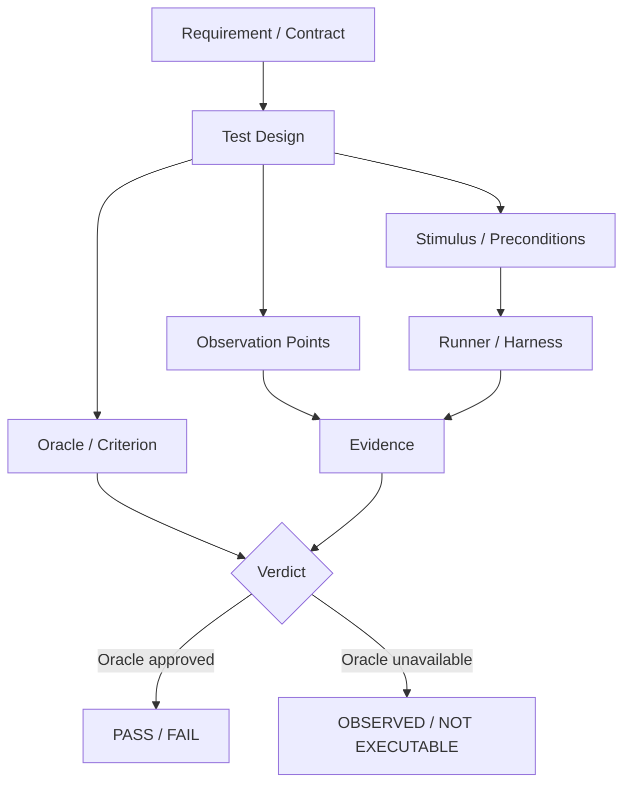

# TRACKBACK — Phase 06 Test Case & Verification Engineering

> Document: 06_TEST_VERIFICATION_ENGINEERING_KO  
> Version: 0.3  
> Status: REVIEWED_DRAFT  
> Canonical: YES  
> Last Reviewed: 2026-10-10  
> Runtime Baseline: repository tests plus capability-gated player workbench  
> Scope: reference TC and verification design; execution and verdict authority remain separate

> **버전:** v0.3 · **작성일:** 2026-10-10 · **상태:** `REVIEWED_DRAFT / NOT APPROVED`
>
> 이 문서는 Phase 05의 **미승인 요구사항 후보**를 시험 설계로 연결한다. 테스트 케이스를 많이 만드는 것이 목적이 아니라, **어떤 요구사항을 어떤 경계에서 무엇으로 자극하고 무엇을 관측하며 어떤 근거로 PASS/FAIL 할 수 있는지**를 고정하는 단계다. 현재 코드 감사에서 확인되지 않은 기능·Oracle·타이밍·안전 등급은 임의 생성하지 않는다.

## v0.3 Phase 08 verification entity contract

Phase 08 schema는 `TestEnvironment`, `Harness`, `Stub`, `MeasurementPoint`, `ExpectedSource`, `ExecutionRun`, `CoverageArtifact`를 서로 다른 entity로 표현해야 한다. 이번 pass에서는 runner를 구현하지 않는다.

`REFERENCE_TC`, `AUTOMATED_REPOSITORY_TEST`, `PLAYER_WORKBENCH_EXECUTABLE`, `OBSERVATION_ONLY`, `INTERFACE_COMPARABLE`은 독립 capability다. Pairwise는 Oracle이 아니며, Fault Injection은 Diagnostic Detection이 아니고, code coverage는 requirement coverage가 아니다. `OBSERVED`는 expected-source가 승인되기 전 `PASS/FAIL`이 아니다. Registry edge는 endpoint comparison이 아니며 MIL/SIL/B2B는 명시적인 두 execution representation 없이는 주장할 수 없다.

## 1. 이번 Phase의 산출 범위

- Phase 05 요구사항 후보: **180개**
- 논리 Function: **74개** (`VERIFIED 5 / PARTIAL 27 / DESIGN_ONLY 42`)
- LF별 기본 TC 설계 후보: **74개**
- 요구사항→TC 후보 추적 링크: **222개**
- 현재 runtime에 대해 별도로 정의한 회귀/특성화 후보: **23개**

**중요:** 74개 LF별 TC 후보는 74개 기능이 실행 가능하다는 뜻이 아니다. `DESIGN_ONLY` 기능의 TC는 **향후 구현을 위한 reference test specification**이고 현재 실행 버튼이나 PASS/FAIL을 가져서는 안 된다.

## 2. 검증 계층



### 2.1 Verdict는 실행했다는 사실만으로 생기지 않는다

`PASS/FAIL`을 허용하려면 최소한 다음이 필요하다.

1. 승인된 또는 명시적으로 현재 TRACKBACK 회귀 범위로 제한된 **criterion**
2. 입력·선행조건·관측 위치의 정의
3. Expected 계산의 출처와 calibration status
4. tolerance/시간 조건이 필요한 경우 그 근거
5. 시험 runner가 실제 해당 target을 실행한다는 증거

이 조건이 없으면 결과는 `OBSERVED`, `REFERENCE_ONLY`, `NOT_EXECUTABLE` 중 하나다.

## 3. Test Case 표준 스키마

각 TC는 다음 필드를 가진다.

| 필드 | 의미 |
|---|---|
| `tcId` | 변경되지 않는 기술 ID |
| `linkedRequirementIds` | 검증하려는 SYSR/SWR/SIMR. FR은 하위 요구사항 coverage로 추적 |
| `targetType/target` | Function, Interface, State, Plant, Timing 등 |
| `preconditions` | 시작 상태와 유효성 조건 |
| `stimulus` | 입력값·프로파일·fault injection event |
| `monitor` | 실제 관측점. 단순 registry edge와 구분 |
| `oracleType` | exact/range/relationship/state-transition/interface-equality/none |
| `expected` | 독립 근거가 있는 expected 또는 symbolic criterion |
| `tolerance` | 값/시간 허용오차. 근거 없으면 OPEN |
| `clockBasis` | tick start/end/event/observation 시각 |
| `executionCapability` | executable/observation/reference-only 등 |
| `calibrationStatus` | 사용된 parameter의 검토 상태 |
| `evidenceProvenance` | C/WASM run, vehicle scenario, static analysis, repo test 등 |
| `verdictPolicy` | PASS/FAIL 가능 범위 또는 OBSERVED |
| `coverageTags` | requirement/state/boundary/interface/code coverage 대상 |

## 4. 요구사항 수준별 검증 원칙

### FR
FR을 단일 unit TC 하나로 검증하지 않는다. 하위 SYSR의 coverage와 필요할 경우 end-to-end scenario/analysis로 확인한다.

### SYSR
시스템 경계의 입력→결과 관계를 검증한다. 여러 SW/host/plant owner가 참여하면 단일 component test만으로 SYSR 전체 PASS를 선언하지 않는다.

### SWR
해당 SW 계산·상태·출력 owner가 실제 존재하고 호출되는 경우 component/unit 수준의 requirements-based test를 구성한다. owner가 없으면 reference-only다.

### SIMR
게임/호스트/물리 시뮬레이션의 계약을 검증한다. 이는 실차 ECU 요구사항이나 OEM calibration 검증으로 확대하지 않는다.

## 5. 현재 TRACKBACK의 실제 검증 능력 기준선

현재 감사 기준으로 신뢰할 수 있는 범위는 다음처럼 제한한다.

- C/WASM `VMC`와 `eDrive`에 대한 component seam이 존재한다.
- Vehicle Scenario는 Rapier 실제 실행 경로를 사용하지만 차량 궤적에 대한 승인 Expected가 없으면 `OBSERVED`다.
- eDrive→DriveAdapter는 source/destination을 별도 객체로 기록하는 **same-tick interception seam**이 있으나 실제 network TX/RX가 아니다.
- Fault Injection은 accelerator override와 eDrive override/drop 지점에 제한된다.
- 실행 시간 기준은 `SIM_FIXED_STEP_60HZ = 1/60 s` 하나다. 별도 ECU runnable/CAN timing은 없다.
- Repository automated test와 Player Workbench 실행 capability는 별개다.

## 6. 74 LF별 기본 TC 설계

`06_TEST_CASE_CATALOG.csv`에는 74개 LF 각각에 최소 1개의 **시험 설계 슬롯**을 만들었다. 모든 항목의 `oracleStatus`는 현재 Phase 05 기준 `NO_APPROVED_CANDIDATE_ORACLE`이므로 자동 PASS/FAIL은 기본적으로 금지한다.

설계 방식은 기능 특성에 따라 다음을 기본값으로 사용한다.

- 입력/유효성: 동등분할 + 경계값
- 상태/모드/고장반응/복귀: 상태전이 + 결정표
- 생성/제한/해석: 요구사항 기반 + 입력변형 + 경계값
- Port/Command/Actuation: Interface test
- Scheduler/Clock: Timing test
- ADAS/Stability/Plant: Scenario test
- Fault manager: Fault injection은 **자극 수단**일 뿐 detection/reaction oracle과 분리

## 7. 현재 Runtime 회귀/특성화 시험

`06_CURRENT_RUNTIME_REGRESSION_CANDIDATES.csv`의 23개 항목은 **현재 구현을 보존하거나 정확히 특성화**하기 위한 후보다. 이 결과는 `TRACKBACK_CURRENT_BEHAVIOR_REGRESSION_ONLY` 범위이며 실차 공학 승인 근거가 아니다.

예:

```text
Propulsion input handling
→ current P/N inhibit / invalid handling

Trackback_VMC
→ 현재 component oracle 범위의 torque generation

eDrive
→ FWD/REV directional limit의 calibration boundary

eDrive → DriveAdapter
→ no-fault equality / override / drop seam

Vehicle Scenario
→ CONSTANT / STEP / LINEAR_RAMP
→ 실제 Rapier response 기록
→ trajectory oracle 없으면 OBSERVED
```

## 8. Interface Verification

Interface 검증은 세 수준을 분리한다.

1. `STRUCTURAL_EDGE`: 설계/registry상 producer→consumer 관계
2. `RUNTIME_TRANSFER`: 실제 call/data copy가 존재
3. `ENDPOINT_COMPARABLE`: source와 destination을 독립된 observation으로 비교할 수 있음

현재 full comparison이라고 부를 수 있는 유일한 경계는 eDrive→DriveAdapter의 instrumentation seam이지만, 이것도 **동일 함수 안의 interception 객체**이며 bus/network 검증은 아니다.

향후 interface TC에는 최소 다음을 추가한다.

- source technical ID / destination technical ID
- unit/type/range/validity 양단 계약
- original/delivered 값
- delivery event/tick ID
- hold/drop/override semantics
- latency/timeout은 실제 transport 모델이 생긴 뒤에만 사용

## 9. Fault Injection Verification

현재 Fault Injection과 ECU Fault Management는 분리한다.

```text
Injection event
→ first observable deviation
→ (future) detection
→ (future) confirmation
→ (future) reaction
→ (future) recovery guard
```

현재 확인 가능한 것은 앞의 두 단계 일부뿐이다. `INJECTOR_RESTORED`를 ECU recovery PASS로 사용하지 않는다.

## 10. Back-to-Back

현재 독립된 두 실행 모델이 연결되어 있지 않으므로 **Back-to-Back은 NOT AVAILABLE**이다.

향후 MIL/SIL 또는 Reference Model/C code를 함께 실행하게 되면 다음 계약이 필요하다.

- 같은 입력 vector와 precondition
- sample/time alignment
- numeric tolerance
- fixed-point/float 변환 규칙
- state initialization
- calibration version 동일성/의도된 차이
- output-by-output comparison 및 mismatch evidence

단순히 MIL 한 번, SIL 한 번 실행했다는 사실만으로 B2B가 되지는 않는다.

## 11. Pairwise

Pairwise는 입력 조합 수를 줄이는 **test data generation technique**이다. 예를 들어 `direction × validity × state × range partition`의 조합을 전수 대신 pair coverage로 축소할 수 있다.

하지만 Pairwise는 다음을 대신하지 않는다.

- 요구사항 기반의 필수 경계값
- 상태 전이 coverage
- fault-specific scenario
- 독립 Expected/Oracle
- structural coverage

따라서 Phase 06에서는 `PAIRWISE_ELIGIBLE` 태그만 정의하고 자동 PASS 기준으로 사용하지 않는다.

## 12. 구조 커버리지

현재 저장소 감사에는 statement/branch/MC/DC instrumentation 근거가 없다. 따라서 달성률을 만들지 않는다.

향후 코드 coverage를 붙일 때는 다음을 분리한다.

- Statement coverage
- Branch/Decision coverage
- MC/DC
- Requirements coverage

특히 MC/DC 목표는 HARA/ASIL 또는 프로젝트 품질 기준이 정해진 뒤 승인해야 한다. **모든 함수에 무조건 MC/DC 100%를 요구하지 않는다.** 또한 structural coverage 100%가 요구사항 기반 시험의 충분성을 증명하지 않는다.

## 13. Test Design Completion Gate

TC를 `APPROVED_TEST_SPEC`으로 승격하려면:

- linked requirement statement가 승인됨
- 적용하는 signal/interface contract가 승인됨
- precondition과 input partition이 정의됨
- monitor 위치가 runtime에서 관측 가능함
- oracle provenance와 calibration status가 명시됨
- tolerance/time basis가 필요한 경우 승인됨
- reset/replay semantics가 있음
- DESIGN_ONLY 기능이면 구현 전까지 executable로 표시하지 않음

TC 실행 결과를 `PASS/FAIL` evidence로 승격하려면 여기에 **실제 runner capability**까지 추가로 확인해야 한다.

## 14. Phase 07로 넘기는 것

Phase 07 Fault Case Engineering에서는 여기서 만든 정상/경계 TC를 기준으로 다음을 추가한다.

- 어떤 deviation을 fault stimulus로 줄지
- 어디에 injection point를 둘지
- 어떤 signal이 처음 달라지는지
- root-cause truth와 player-visible evidence를 어떻게 분리할지
- 고장을 제거한 corrected replay에서 어떤 regression TC를 다시 실행할지

**Fault Case가 새로운 Oracle을 임의 생성해서는 안 된다.** 먼저 Phase 05 요구사항과 Phase 06 TC/Oracle 계약이 있어야 한다.

## 15. 이번 Phase의 미승인 사항

- 74 LF 전부의 detailed Expected 값
- 전체 Vehicle expected trajectory
- ABS/ESC/AEB/LKA 등 DESIGN_ONLY 기능의 실행 runner
- DTC/detection/recovery verdict
- ECU task/CAN timing verdict
- B2B
- code structural coverage 목표/달성률
- HARA/ASIL에 따른 안전 검증 강도

이 항목들은 결손을 숨기지 않고 다음 engineering gate로 전달한다.
