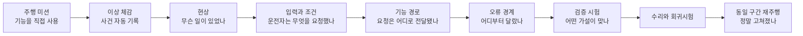
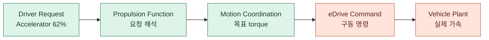
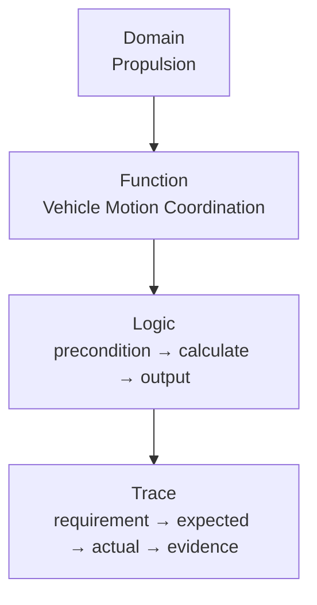

# TRACKBACK V2 조사·교육 경험 상세 설계

> **2026-10-18 이전 설계 기록:** 현재 독립 프로젝트 설계는 `trackback-v2/docs/PRODUCT_ARCHITECTURE.md`와 `trackback-v2/docs/MIGRATION_MATRIX.md`를 따른다.

> 결정: 기존 조사실의 시각 정체성은 유지하지만 게시판형 workspace는 폐기한다. V2는 운전자 시야에서 시작해 사건을 재생하고, 차량 내부의 기능 경로를 따라가며, 가설을 시험한 뒤 같은 구간을 재주행하는 장면형 추리 게임으로 만든다.

## 1. 왜 단계형 장면이 필요한가

현재 방식은 scene, 운전자 의견, signal, requirement, test, clue, timeline을 동시에 보여준다. 정보는 많지만 플레이어가 지금 무엇을 판단해야 하는지가 약해진다. 페이지를 단순히 더 많이 나누는 것도 해결책은 아니다. 각 장면이 하나의 실무 질문을 담당해야 한다.



각 장면에는 기본 질문 하나, 조작 하나, 완료 조건 하나만 둔다. clue는 페이지 방문 보상이 아니라 올바른 판단을 기록했을 때 얻는다.

## 2. 플레이어 화면 구성

| 장면 | 화면의 질문 | 주요 시각 요소 | 플레이어 행동 | 배우는 실무 사고 |
|---|---|---|---|---|
| 0. Job Brief | 오늘 무엇을 검증하나? | 지도, 검증 구간, 완료 조건 | 주행 시작 | test objective와 성공 조건 |
| 1. Drive | 지금 어떤 기능을 사용해야 하나? | 도로 장면, route, speed/delta, cockpit input overlay | 조향·가속·제동·기어 조작 | 조건 안에서 기능을 의도적으로 사용 |
| 2. Incident Replay | 실제로 무슨 일이 있었나? | 6초 replay, 운전자 한마디, 요청·조건·반응 | 사건 전후 scrub | 증상과 root cause 분리 |
| 3. Driver Request | 사용자의 요청은 유효했나? | steering/pedal/gear/READY 계기 | 관련 입력 2개 선택 | input과 precondition 확인 |
| 4. Vehicle X-Ray | 요청은 차 안에서 어디로 갔나? | episode subgraph, 흐르는 signal | 경로를 따라 node 선택 | domain과 function chain 이해 |
| 5. Fault Boundary | 최초 차이는 어디인가? | 두 node의 Actual/Expected | last normal / first abnormal 선택 | 고장 범위 좁히기 |
| 6. Test Bench | 어떤 시험이 가설을 구분하나? | 조건, 변경 입력, 관찰 출력, 예상 결과 | preset 선택·실행 | 재현, 변수 통제, oracle |
| 7. Report | 무엇을 근거로 결론냈나? | location, type, clue 3장 | 보고서 제출 | evidence sufficiency |
| 8. Repair / Re-drive | 수정 후에도 정상인가? | regression stamp, before/after trace, 동일 구간 | 재주행 | corrective action과 regression |

## 3. 주행 화면: 운전자 시점의 의미

운전자 시야는 몰입용 장식이 아니라 조사 근거의 출발점이다.

### 1주 MVP

- 기존 3D 도로·차량 camera를 유지한다.
- 화면 하단에 반투명 cockpit strip을 추가한다.
- steering wheel angle, accelerator, brake, gear, DRIVE READY를 실제 조작과 동기화한다.
- 사건 발생 시 strip 전체를 붉게 만들지 않고, 관련 control만 짧게 강조한다.
- 운전자 대사는 한 번에 두 문장을 넘기지 않는다.

```text
┌──────────────────────────────────────────────────┐
│                 기존 주행 canvas                 │
│        route / traffic / signal / checkpoint     │
│                                                  │
│  다음 검증 지점 180m                    +1.2s    │
├──────────────────────────────────────────────────┤
│  ◔ steering -8°   ACC 62%   BRK 0%   D · READY │
└──────────────────────────────────────────────────┘
```

완전한 실내 cockpit 모델은 이후 단계다. 1주 안에 새 steering wheel/gear/pedal 3D 모델, 실내 camera collision, 차량별 interior를 만들면 핵심 episode 완주가 밀린다. 먼저 입력과 차량 반응의 인과가 읽히는 overlay로 검증한다.

## 4. 차량 X-Ray: 구조를 외우지 않고 따라가게 하기

전체 아키텍처는 기본 화면에서 금지한다. 현재 사건과 관련된 경로만 보여주고 사용자가 확대할 때 정보를 더 연다.



### 확대 수준



- Domain view: 차량의 어느 계통을 보고 있는지 이해한다.
- Function view: 요청과 반응 사이의 역할 분담을 이해한다.
- Logic view: 어떤 조건에서 어떤 입력이 어떤 출력으로 변해야 하는지 이해한다.
- Trace view: 요구사항과 실행 증거를 연결해 결론의 근거를 확인한다.

node 선택 시 우측 작은 카드에는 `역할`, `받는 값`, `보내는 값`, `왜 지금 보는가`만 표시한다. canonical ID, 파일 경로, approval, 원문 출처는 `기술 상세` drawer로 보낸다.

## 5. 추리 게임으로서의 규칙

단서를 찾는 재미는 숨겨진 텍스트를 클릭하는 데서 만들지 않는다. 서로 경쟁하는 설명을 줄이고, 한 번의 선택이 다음 관찰을 바꾸게 한다.

Episode 01의 예:

- 관찰: accelerator 62%, D/READY, 가속 부족
- 가설 A: 운전자 요청 또는 주행 조건이 유효하지 않았다.
- 가설 B: propulsion request까지는 정상이지만 eDrive output이 작았다.
- 가설 C: 명령은 정상이지만 물리 vehicle response가 달랐다.
- 선택: 45 Nm와 90 Nm를 같은 조건에서 비교한다.
- 결과: 두 입력이 같은 비율로 축소되면 scaling fault를 지지한다.
- 한계 문장: 이 결과는 output scaling 위반을 입증하지만 특정 코드 줄을 직접 증명하지 않는다.

오답은 life 차감보다 새 관찰을 준다. 예를 들어 조건이 다른 두 run을 비교하면 `입력 외 조건도 달라 결론을 낼 수 없습니다`라고 알려주고 조건 고정으로 돌아간다. 이는 실제 검증 사고 훈련과 게임의 재도전을 같은 규칙으로 만든다.

## 6. 교육성과 게임성을 분리하지 않는 장치

| 게임 장치 | 즉각적 재미 | 교육 효과 |
|---|---|---|
| 검증 checkpoint | 목적지와 긴장감 | 기능 사용 조건을 몸으로 경험 |
| incident replay scrub | 사건 다시 보기 | event window와 재현 조건 이해 |
| signal flow animation | 고장 경로 추적 | producer/consumer와 interface 이해 |
| clue stamp | 수집·진행감 | 주장과 evidence를 묶는 습관 |
| competing hypotheses | 추리 선택 | 조기 결론 방지 |
| controlled test preset | 결과 예측의 긴장감 | 변수 통제와 oracle 이해 |
| same-event re-drive | 회복의 카타르시스 | regression과 재검증 이해 |

점수는 `Driving`, `Investigation`, `Resolution`으로 분리한다. 빠른 주행이 조사 정확도를 보상하거나, 오래 고민한 시간이 engineering verdict를 깎지 않게 한다.

## 7. Episode와 자유 학습의 분리

### Episode Mode

- 사건과 연결된 subgraph만 노출
- 초회는 guided sequence
- 각 장면 한 질문, 한 CTA
- 8~12분 안에 완결

### Vehicle Atlas

- episode 완료 후 자유 탐색
- 전체 domain 지도를 먼저 보여주되 domain은 접힌 상태
- function, logic, requirement, source를 단계적으로 탐색
- 완료한 episode의 경로를 색으로 표시
- 실제 실행 가능한 component와 reference-only component를 badge로 구분

Vehicle Atlas는 본편을 막는 교과서가 아니라, 사건을 해결한 뒤 `내가 방금 본 기능이 차 전체에서 어디에 있는가`를 복습하는 공간이다.

## 8. UI 시각 방향

유지할 요소:

- 기존 베이지/민트 palette와 포인트 컬러
- 둥근 카드, 종이 기록, 스탬프, 정비소 감성
- 고양이 운전자와 차량 verification 세계관
- 기존 3D 맵과 차량 자산

바꿀 요소:

- 웹 게시판처럼 보이는 고정 3열 layout
- 페이지 번호와 도구 이름 중심 navigation
- 긴 설명문, 상시 timeline, 상시 clue rail
- 접힌 콘텐츠가 빈 높이를 차지하는 layout

새 장면은 `배경 장면 70% + 현재 판단 카드 30%`를 기본 구도로 한다. 기술 표를 중심에 두는 대신 차량, 계기, 흐름도, before/after가 화면의 주인공이 된다.

## 9. 1주 수직 슬라이스 범위

반드시 구현:

1. 기존 주행 canvas + cockpit input overlay
2. Event C와 연결된 incident replay
3. Driver Request 장면
4. 5-node Vehicle X-Ray
5. last normal / first abnormal 선택
6. 45/90 Nm test preset
7. clue 3장 report
8. repair regression + 동일 Event C 재주행

후순위:

- 완전한 first-person 3D interior
- 전체 차량 domain atlas authoring tool
- 복수 traffic AI와 신호등 state machine
- 여러 episode 사이 progression
- 자유 hypothesis builder

이 범위를 지키면 1주 안에 `운전 → 이상 체감 → 구조 이해 → 고장 경계 추적 → 시험 → 수리 → 재검증`이 끊기지 않는 한 편을 만들 수 있다.
